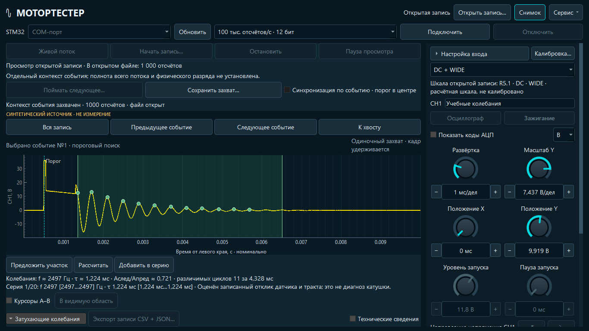

# Мотортестер V2

Учебный проект одноканального мотортестера для Windows 10: приложение, прошивка
STM32F103C8T6 и материалы аналогового входа. Текущий этап приложения — **V2-21**.
Один физический канал **CH1**, профили **«Осциллограф» / «Зажигание»**,
живой график, запись и анализ в одном окне с крутилками.

Публикуются исходники. Для запуска используйте команды ниже; наличие готового
публичного EXE-релиза эта инструкция не предполагает. Фактические проверки
и аппаратные ограничения собраны в [прогрессе проекта](docs/progress.md).



На снимке — учебная запись, не измерение катушки.

## Что умеет приложение

- Получать поток STM32 через USB / COM-порт: 50 или 100 тыс. отсчётов/с
  с сохранением 12 бит; 150 тыс. отсчётов/с с сохранением 10 бит, если режим
  поддерживает прошивка. Это частота дискретизации, а не полоса аналогового входа.
- Записывать поток, открывать записи, сохранять отдельный захват, экспортировать
  CSV + JSON. Исходные коды, разрывы и профиль входа сохраняются.
- Масштабировать график, измерять курсорами A–B, находить пороговые события,
  удерживать их в кадре и переходить между ними без остановки записи.
- Показывать Min / Max / размах, среднее DC, период и частоту видимого участка,
  а также отдельную частоту найденных событий в живом приёме.
- Настраивать расчётную шкалу CH1 и выполнять отдельную калибровку DC / AC
  с контрольной точкой, сохранением исходных данных и отчётом PDF.
- Оценивать частоту и затухание колебаний на выбранном участке, показывать
  исходные пики и сводку серии событий. Это анализ сигнала, не диагноз катушки.

## Быстрый запуск из исходников

Нужны Windows x64, Git и обычный **CPython 3.14.7 x64** с командой `py`.
В PowerShell выполните:

```powershell
git clone https://github.com/font-weight/stm32_motortester_v2.git
cd stm32_motortester_v2
py -3.14 -m venv .venv
.\.venv\Scripts\python.exe -m pip install -r host\requirements-gui.txt
.\run_v2.cmd
```

Интернет нужен для получения исходников и зависимостей. Активировать `.venv`
не требуется. Для следующих запусков достаточно открыть **`run_v2.cmd`**.
Если скачали репозиторий через **Code → Download ZIP**, распакуйте его,
откройте PowerShell в полученной папке и начните с команды создания `.venv`.

Приложение открывается без подключения и без автоматически запущенного ДЕМО.
[Другие команды запуска и сведения для разработчика](host/README.md).

## Попробовать без платы

Откройте **«Сервис → ДЕМО для проверки → Осциллограф»** или **«Зажигание»**.
Можно менять развёртку, включать курсоры и делать учебные записи.
ДЕМО явно обозначено и не использует COM-порт.

Для нового анализа выберите **«Сервис → ДЕМО для проверки → Затухающие
колебания · учебная запись»**, затем внизу окна включите
**«Затухающие колебания»**, нажмите **«Предложить участок»**, осмотрите его
и нажмите **«Рассчитать»**. У искусственного примера заданы 2500 Гц и τ = 1,2 мс.
[Что означают показатели и когда расчёт недоступен](docs/ringdown.md).

Мастер **«Калибровка…»** находится справа. Источник **«Учебный поток · без платы»**
позволяет пройти его без аппаратуры; такой результат нельзя применить к прибору.
[Пошаговая инструкция калибровки](docs/calibration-wizard.md).

## Подключить STM32 и записать сигнал

Нужна плата с совместимой прошивкой V2; приложение само её не прошивает.
Поддерживаемые режимы определяются при подключении. Подробности —
[протокол и пакетный приём](docs/streaming-batch1024.md).

1. В верхней строке выберите COM-порт и частоту, нажмите **«Подключить»**.
   Приём начинается отдельно.
2. Если аналоговый тракт ещё не подключён, оставьте **«Прямой PA0 / неизвестный
   вход»**: будут показаны коды АЦП. Для подключённого входа R5 выберите справа
   фактический режим **DC + WIDE**, **AC + WIDE** или **AC + SENSITIVE**.
   Раскройте **«Настройка входа»**, укажите экземпляр платы, подтвердите положения
   физических переключателей и нажмите **«Применить вход»**.
3. Задайте **«Уровень запуска»**, **«Пауза запуска»** и остальные параметры
   поиска, затем нажмите **«Применить поиск»** и **«Живой поток»**.
4. Для сохранения нажмите **«Начать запись…»** и выберите новое имя `.mtstream`.
   **«Пауза просмотра»** удерживает график; приём и запись продолжаются.
5. **«Остановить»** завершает приём. Кнопка **«Открыть запись…»** открывает
   `.mtstream`, `.mtshot`, `.mtv2` и `.mtcap` в том же окне.
   Для нового подключения снова используйте **«Подключить»**.

Файл `.mtstream` храните вместе с соседним `.mtstream.v2.json`, содержащим
контекст и профиль. Просмотр и экспорт не изменяют оригинал.
[Полная инструкция главного окна](docs/unified-ui.md).

## Напряжение и аппаратные границы

В/мВ означают напряжение на **разъёме CH1 перед входным делителем**.
Это не напряжение на ножке АЦП и не киловольты вторичной цепи зажигания.
Неизвестный вход остаётся в кодах АЦП. Расчётная шкала не является калибровкой;
каждый режим имеет свои коэффициенты. AC не измеряет постоянную составляющую.

Профиль «Осциллограф» / «Зажигание» не переключает физические S1/S2.
DC + SENSITIVE не принят как рабочий режим. Подготовка программы и схемы
не подтверждает защиту, допустимое напряжение, полосу или готовность к автомобилю.
Для аппаратных действий используйте [первое включение R53](docs/guides/r53-first-power-ru.md)
и [условия физической проверки](docs/validation.md).

## Где искать подробности

| Задача | Документ |
| --- | --- |
| Управление, запись, захват и курсоры | [Главное окно](docs/unified-ui.md) |
| Режимы и пересчёт напряжения | [Аналоговый вход](docs/stream-analog-input.md) |
| Калибровка DC / AC, исходные данные и PDF | [Мастер калибровки](docs/calibration-wizard.md) |
| Показатели графика и частота событий | [Видимый участок](docs/segment-measurements.md), [события](docs/event-frequency.md) |
| Анализ затухающих колебаний | [Инструкция](docs/ringdown.md) |
| Самодельный ёмкостной датчик | [Сборка датчика](docs/guides/capacitive-pickup-ru.md) |
| Продолжение разработки | [Текущая задача](task.md), [требования](requirements.md), [решения](docs/decisions.md), [прогресс](docs/progress.md) |

Код приложения — `host/motortester/v2/`, прошивка — `firmware/`, аппаратные
материалы — `hardware/`, исходные задания — `docs/design/`. Правила изменений
и приёмки — [AGENTS.md](AGENTS.md) и [quality-gate](docs/quality-gate.md).
Состав опубликованных исходных материалов и актуальный проект платы пояснены
в [памятке к публикации](docs/design/PUBLICATION_RU.md).
Исходный [stm32_motortester](https://github.com/font-weight/stm32_motortester)
сохраняется как источник прежних наработок; разработка ведётся в этом V2-репозитории.

Лицензии имеют ограниченную область: [host/LICENSE](host/LICENSE) не назначает
MIT всему репозиторию или каталогу V2; см. [точный перечень](host/docs/project-license.md).
Публичный бинарный выпуск требует отдельной [проверки лицензий зависимостей](host/packaging/LICENSE-REVIEW.md).
