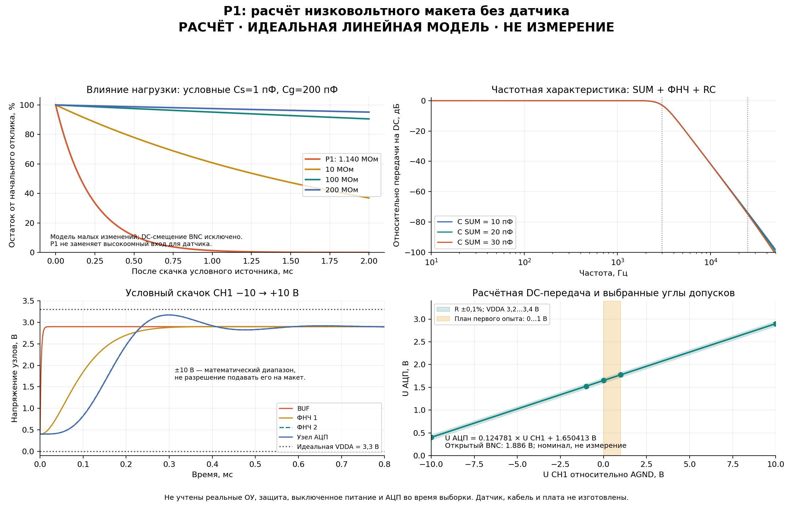
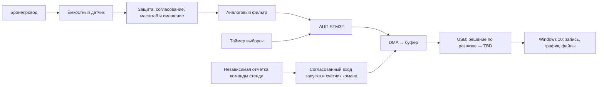

# Архитектура и расчёты V2

## HW-V2-02 P1-LV

Расчёт отдельного однополярного лабораторного макета, не входа зажигания.
[Соединения и номиналы](../hardware/v2-input/p1-lv/netlist.md),
[идеальная модель](../hardware/v2-input/p1-lv/model.py).
Приведённые числа — результаты уравнений при допущениях ниже, не измерения.

### DC, нагрузка и смещение

`Rs=499k+499k=998k`, `Ru=249k`, `Rd=332k`,
`Rth=1/(1/Rs+1/Ru+1/Rd)`, `k=Rth/Rs`, `β=Rth/Ru`.
Идеальные повторители и ФНЧ на DC дают:

`U_ADC = k·U_CH1 + β·V_A = 0,1247807567·U_CH1 + 0,5001252819·V_A`.

При условных 3,300 В: ноль на CH1 даёт 1,650413 В;
`a=V_A/(4096k)=0,0064566371 В/код`, `b=−βV_A/k=−13,226506 В`.
Это номинальная арифметика, коэффициенты не назначаются текущей плате.
На первом участке 0…1 В размах составляет лишь около 155 кодов:
малый опыт не доказывает точность широкого диапазона или разрешение в микровольтах.

Вид со стороны CH1: `Rin=Rs+(Ru||Rd)=1,140286 МОм`,
`Vopen=V_A·Rd/(Ru+Rd)=1,885714 В`.
Следовательно, это не заземлённые «1 МОм осциллографа»: короткий на AGND
принимает ток `Vopen/Rin≈1,654 мкА`. Реальное U_CH1 высокоомного источника
меняется при подключении. Низкоомный источник допускает изучение самого
тракта, но не доказывает работу пассивного датчика.

Rth SUM≈124,531 кОм; гипотетические суммарные 10/20/30 пФ дают
полюса 127,8/63,9/42,6 кГц. Ёмкость кабеля перед Rs и ёмкость SUM после Rs
не складываются в один узел без анализа. Утечка в SUM 1 нА даёт около
0,125 мВ на ADC и 0,998 мВ в пересчёте ко входу. Здесь нет обещания утечки
или точности TLV9064: ток/смещение/температура/монтаж проверяются отдельно.

### Фильтр и шаг

Две номинальные секции повторяют P0 ниже; P1-модель дополнительно учитывает
условные 20 пФ на SUM и выходные 330 Ом/1 нФ. Частотная передача нормирована
к DC-усилению k. Перебор фильтра: R5…R8 ±0,1%, C ±2%, R9 ±1%;
Rth/C_SUM при этом номинальные, V_A считается идеальной жёсткой шиной.
Это не полный бюджет погрешности и не Monte Carlo реальных компонентов.

Переход интегрируется RK4 по шести состояниям: SUM/BUF, выход/производная
каждой секции и ADC_NODE. Все ОУ идеальные, перегрузка не обрезается.
Проверка изменения шага и установившегося решения оценивает численную
арифметику; устойчивость реального ОУ из неё не следует.
Модель не включает токовые ограничения, пуск, выключение и ADC sample-and-hold.

Показателен идеальный переход −10 → +10 В: LP2 достигает около 3,171 В;
обратный переход — около 0,130 В. По DC на границах было 0,403…2,898 В.
Таким образом, даже хорошие DC-границы не гарантируют запас при скачке;
**±10 В не назначаются рабочим/защищённым диапазоном**. Первый будущий опыт —
местный DC_TEST 0…1 В с JP_ADC снятой. Переходы ±1/±10 в модели являются
исследовательскими сценариями, не указаниями подавать эти напряжения.

### Местный DC_TEST и прибор

Пусть q — доля RV1=10 кОм от земли до движка, R10=33 кОм, R11=1 кОм.
`Rbottom=q·RV1`, `Rtop=R10+(1−q)·RV1`,
`Vtest=V_A·Rbottom/(Rtop+Rbottom)`,
`Rtest=R11+(Rtop||Rbottom)`.
При q=0 параллельное сопротивление считается нулём.
Нагруженный разъём:
`U_CH1=(Vtest/Rtest+Vopen/Rin)/(1/Rtest+1/Rin)`.

При q=0/0,5/1 получаются 0,001652 / 0,390825 / 0,775885 В.
Перебор R10/R11 ±1%, RV1 ±20%, делителя ±0,1%, V_A=3,2/3,4 В
даёт максимум около 0,922 В. Он не покрывает ошибку монтажа или обрыв земли.
Точный ноль задаётся отдельным замыканием CH1–AGND.

Мультиметр с условным входом 10 МОм добавляет `1/Rmeter` в знаменатель.
При верхнем положении его снятие повысило бы U_CH1 примерно на 0,667 мВ.
Это **пример**, сопротивление/точность сообщённого RICHMETERS 102 пока не
проверены. На калибровочных точках нужно сохранять одинаковую конфигурацию
измерителя или учитывать её влияние; показания измерять на CH1 с нагрузкой.

### Почему P1 не заменяет вход датчика

В линейном приращении для условных Cs=1 пФ, Cg=200 пФ, t=2 мс
эквивалентная нагрузка P1 даёт спад около 99,984%, 10 МОм — 63,03%,
100 МОм — 9,47%, 200 МОм — 4,85%. Это сравнение RC-чувствительности,
не реконструкция искры; для P1 отдельно существует ненулевое DC-смещение.
Обзор в модели включает Cs=0,2/1/5 пФ, Cg=50/200/500 пФ. Все значения
гипотетические; фактические ёмкости будущего датчика/кабеля TBD.
Снижение нагрузки ради простой схемы нельзя скрыть программным масштабом.

## HW-V2-01 P0: DC-вход для пассивного ёмкостного датчика

Расчётное предложение от 20.10.2026. Область и неизвестные условия —
[hardware-input.md](hardware-input.md); соединения —
[P0/netlist.md](../hardware/v2-input/netlist.md). Ниже идеальные линейные модели
и проверяемая арифметика, а не измеренные характеристики или готовая PCB.
Эти расчёты не меняют приложение/firmware; текущий CH1 остаётся
`unconfigured` до физического подтверждения и явного назначения профиля.

### Условие питания и доступная метрология

Одиночный ЛБП пользователя примерно 0…20 В не обеспечивает расчётные ±15 В.
Таблицы ниже сохранены как условный вариант, без обещания диапазона ±10 В.
При искусственной середине 20 В получилось бы питание ±10 В: верхняя
граница common-mode OPA140 тогда около +6,5 В (`V+−3,5 В`), ещё до допуска
питания. Это не эквивалент исходному P0; связь середины с USB AGND отдельно
не подтверждена. Переход на AC-связь здесь не выполняется.

Возможный отдельный узел питания — регулируемый DC/DC от проверенных 12 В
ЛБП с выходами ±15 В; пример и паспортные ограничения —
[TMR 1-1223](sources.md#v2-hw-11). Выходы/COM, фильтр, фактическая нагрузка,
переходные процессы и общая земля должны быть проверены до использования
арифметики P0. Мультиметр способен проверить DC-шины, но паспортные шумы и
импульсы запуска требуют осциллографа. Вариант с проверенным университетским
двуполярным источником не требует сейчас покупать преобразователь.

### Измерение ёмкостей без питания

После появления кабеля доступен опыт: полностью отсоединённый кабель и непитаемый
трёхпроводный макет, без MCU и автомобиля. Записать модель/диапазон/разрешение
измерителя, геометрию и компенсацию щупов. C кабеля отдельно измеряется
между центральной жилой и экраном при свободном противоположном конце.

Для модели с узлами H (внутренняя жила образца изолированного провода),
S (съёмный электрод) и B (экран/опорная поверхность) существуют три
взаимные ёмкости: Cs между H–S, Csb между S–B, Chb между H–B.
В неизменном расположении измерить двухвыводным прибором:

- M1 между S и соединёнными H+B: `M1=Cs+Csb`;
- M2 между H и соединёнными S+B: `M2=Cs+Chb`;
- M3 между B и соединёнными H+S: `M3=Csb+Chb`.

Тогда `Cs=(M1+M2−M3)/2`, `Csb=(M1+M3−M2)/2`,
`Chb=(M2+M3−M1)/2`. Это модель трёх сосредоточенных ёмкостей, а не
гарантия точности бытового измерителя. При предельных ошибках δ1/δ2/δ3
неопределённость разности Cs достигает `(δ1+δ2+δ3)/2`; малый Cs на фоне
большого C кабеля легко теряется. Отрицательная или сравнимая с этой ошибкой
оценка означает недостаточное измерение/модель, а не отрицательную ёмкость.
Положение рук и проводов фиксировать; прибор не держать на включённой цепи.
В RC-модели ниже Cg включает Csb с кабелем и отдельно оценённую ёмкость входа.

### Нагрузка и ёмкостный источник

Пусть Cs — ёмкость связи датчика с изолированным проводом, Cg — совокупная
ёмкость электрода, кабеля, BNC и входа относительно AGND; R — нагрузка.
Для упрощённого пассивного RC:

`H_pickup(s) = s*R*Cs / (1+s*R*(Cs+Cg))`,
`K∞ = Cs/(Cs+Cg)`, `τ=R*(Cs+Cg)`.

Условное плато после фронта уменьшается как `exp(−t/τ)`. Для Cs=1 пФ,
Cg=200 пФ и t=2 мс:

| R | τ | Уменьшение плато за 2 мс |
|---:|---:|---:|
| 10 МОм | 2,01 мс | 63,03% |
| 100 МОм | 20,1 мс | 9,47% |
| 200 МОм | 40,2 мс | 4,85% |
| 1 ГОм | 201 мс | 0,990% |

Условный предел спада 5% требует `R ≥ −t/((Cs+Cg)*ln(0,95)) = 194 МОм`.
Это **не** выбранный допуск реального прибора: Cs/Cg и значимая длительность
ещё не измерены. Большее Cg уменьшает спад, одновременно снижая чувствительность
K∞; добавлять конденсатор только ради «красивого плато» нельзя.

Щуп 10 МОм параллельно 100 МОм даёт 9,09 МОм; его ёмкость также добавляется.
Низкоомная контрольная точка после U1 предпочтительнее прямого щупа на pickup,
но точность самого буфера предварительно надо установить низковольтным опытом.
При токе утечки I ошибка порядка `I*R`: 12 пА дают 1,2 мВ на 100 МОм,
5 нА — уже 0,5 В. Диоды, ОУ, разъём, переключатель и загрязнение платы входят
в этот бюджет. Пикоамперы из паспорта при 25°C не граница для любого нагрева.

### DC-преобразование и диапазоны

U1 — повторитель с двуполярным питанием; в линейном приближении `U_BUF=U_CH1`.
Для узла SUM из R3=100 кОм, R4=24,9 кОм к VDDA и R5=33,2 кОм к AGND:

`D=1/R3+1/R4+1/R5`,
`k=(1/R3)/D=0,124562281`,
`β=(1/R4)/D=0,500250125`,
`U_SUM=k*U_CH1+β*VDDA`.

U2B усиливает относительно буферизованного `VMID=VDDA/2`:

`A=1+190к/Rg`, `U_GAIN=A*U_SUM+(1−A)*VMID`;
`G=A*k`, `U_bias=VDDA*[A*β+(1−A)/2]`.

Rg=разрыв/47,5 кОм/10 кОм даёт A=1/5/20. Постоянный Rf=190 кОм сохраняет
обратную связь между положениями переключателя. После фильтра на DC
`U_ADC≈U_bias+G*U_CH1`. При условной VDDA=3,300 В:

| Диапазон | G | U_bias, В | U_ADC на границах, В | a, В/код | b, В |
|---|---:|---:|---:|---:|---:|
| ±10 В | 0,124562281 | 1,650825 | 0,405203…2,896448 | 0,006467962 | −13,253012 |
| ±2 В | 0,622811406 | 1,654127 | 0,408504…2,899750 | 0,001293592 | −2,655904 |
| ±0,5 В | 2,491245623 | 1,666508 | 0,420885…2,912131 | 0,000323398 | −0,668946 |

Здесь `a=VDDA/(4096*G)`, `b=−U_bias/G`; весь тракт имеет положительный знак.
Номиналы не точно дают 1,650 В во всех диапазонах, поэтому подстановка
универсального «2048 = ноль» неверна. Реальная калибровка `a,b` по двум
DC-точкам включает ОУ/резисторы/опору, но не исправляет клиппинг и полосу.
Ни одна строка автоматически не переносится в текущий HOST-профиль.

Перебор углов ±0,1% семи резисторов/отношений при неизменной VDDA даёт
общие крайние U_ADC 0,402…2,899 / 0,390…2,916 / 0,353…2,978 В соответственно.
Это только резисторная DC-оценка: нет дрейфа, ошибки ОУ, шумов, утечек,
разброса VDDA и переходных процессов. Требование к headroom проверяется
по реальному питанию и всем этим составляющим до подключения MCU.

### Полоса, фильтр и ADC

Расчётный бюджет ёмкости **после** входных 102 кОм — 15 пФ:
`f_p≈1/(2π*102к*15п)=104 кГц`. Это не ёмкость всего кабеля и не измеренная
полоса. Его приближение предполагает низкоомный источник со стороны BNC;
полный pickup надо считать вместе с Cs/Cg/RLOAD.

Для каждой unity-gain секции Sallen–Key:

`H(s)=1/[1+s*Cg*(Ra+Rb)+s²*Ra*Rb*Cf*Cg]`;
при Ra=Rb=R: `f0=1/(2πR√(Cf*Cg))`, `Q=√(Cf/Cg)/2`.

Cf соединяет промежуток между Ra/Rb с выходом ОУ; Cg — вход плюс ОУ с AGND.
Первая секция: R=4,87 кОм, Cf=11,8 нФ, Cg=10 нФ → f0=3008,5 Гц, Q=0,5431.
Вторая: R=2,03 кОм, Cf=68 нФ, Cg=10 нФ → f0=3006,6 Гц, Q=1,3038.
Низкая Q ставится первой; результат близок к Butterworth 4-го порядка:

| Частота | Расчётная передача, дБ |
|---:|---:|
| 1 кГц | +0,0089 |
| 2 кГц | −0,1427 |
| 3 кГц | −2,9539 |
| 10 кГц | −41,7369 |
| 25 кГц | −73,5772 |
| 47 кГц | −95,5107 |

Это расчёт идеальных ОУ/номинальных RC. Разброс C/Q, внутренняя перегрузка,
устойчивость, фаза и ступенчатая характеристика ещё должны быть проверены.
Ограничение U1, U2B или внутреннего узла фильтра может не дать кодов 0/4095:
последующий фильтр сгладит уже искажённый сигнал. Поэтому отсутствие крайних
кодов не доказывает отсутствие перегрузки, а предел диапазона должен учитывать
внутренние пики и отклик на ступень обоих знаков.
Например, `Fs−3к=47к` отражается к краю полосы 3 кГц при Fs=50 кГц;
таблица показывает подавление одного такого тона, но не всего широкополосного
выброса и не нелинейных продуктов перегрузки **перед** фильтром.
Низкочастотная калибровка не превращает −3 дБ на 3 кГц в точную амплитуду.

Текущий [wire 0.1](../protocol/wire-v0.1.md) задаёт номинально ADC 12 МГц,
выборку 71,5 такта, преобразование ещё 12,5: 5,958 мкс и 7,000 мкс суммарно,
при периоде 20 мкс. Для [DS5319](sources.md#v2-hw-02) RADC≤1 кОм,
CADC≤8 пФ; физический R_ADC не равен сопротивлению CH1.

При выходных 330 Ом:
`t_¼LSB≈(330+1000)*8п*ln(2^14)=0,103 мкс`.
Выходной C=1 нФ даёт полюс 482 кГц. Грубая модель перераспределения полного
заряда сначала даёт 32,51 LSB, затем восстановление через 330 Ом:
`e≈32,51*exp(−5,958мкс/(330*1008п))≈5,4·10⁻⁷ LSB`.
Это лишь оценка запаса, не обещание такой ошибки ADC: конечная полоса ОУ,
переключательные выбросы, внутренний цикл и паразитики в модели отсутствуют.
Основание проверки sample-and-hold — [AN2834](sources.md#v2-hw-03).

При 50 kS/s импульс 10 мкс короче интервала выборки, а 3-кГц фильтр дополнительно
снижает его пик. P0 не обещает амплитуду/форму пробоя. Чтобы расширить полосу,
нужно совместно выбирать Fs, время выборки, фильтр и форму исследуемого сигнала;
максимальные 1 MS/s из datasheet не характеристика действующей прошивки.

### Ограничители и границы расчёта

Шунты ±10 В питаются от ±15 В через 10 кОм: номинальный ток 0,5 мА на каждый.
Для **иллюстративного** +24 В и принятого уровня clamp=11,5 В:
`I=(24−11,5)/102к=0,123 мА`,
`P_R=I²*102к=1,53 мВт`,
`I_shunt=0,623 мА`, `P_shunt≈6,23 мВт`.
Отрицательная ветвь симметрична по модулю при тех же допущениях.

Указанные числа не включают форму/энергию искры, ESD, поведение обесточенных шин,
VF при реальном токе/температуре или переходные процессы. Встроенные ESD-диоды
ADC не назначены рабочими ограничителями. Отдельные шунты предотвращают
**проектное** направление тока в VDDA, но это надо подтвердить всей схемой
и опытом, включая отключённый MCU. Допустимый предел CH1 пока TBD.
После ограничения заряд датчика/кабеля может восстанавливаться через RLOAD:
иллюстративные 100 МОм и 201 пФ дают τ=20,1 мс. Типовое время восстановления
самого ОУ из datasheet не является временем восстановления всего входа.

Расчёты воспроизводятся [calculate.py](../hardware/v2-input/calculate.py);
[calculations.json](../hardware/v2-input/calculations.json) содержит допущения,
числа и резисторный перебор. Это не SPICE и не отчёт испытания.

---

Историческая архитектура исходного проекта, предложение 0.3

Этот текст сохранён для происхождения. Старые планы Dot, внешнего запуска,
платформ и режимов не переопределяют текущие требования V2.

# Архитектура: предложение 0.3

Обновление 10.10.2026: MVP — один аналоговый канал на STM32F103C8T6 со встроенным АЦП и native USB FS, приложение Windows 10. Второй канал и автоматический анализ — после основы. Полный объём — в [mvp-spec.md](mvp-spec.md). Структура и численные примеры ещё не подтверждены измерениями. Сравнения других платформ ниже сохранены как расчёты для будущего развития.

## Измерение и ответственность узлов

DMA переносит отсчёты в память без обработки процессором каждой выборки. Прошивка отвечает за захват и передачу; ноутбук — за файлы, график, управление и справку. Стек Windows-приложения Dot выбирает в MVP-00 по совместимости и воспроизводимой упаковке; Python не является обязательным выбором. Питание, опорный потенциал и развязка — в [аппаратной части](hardware.md).

Будущий анализ предполагается на ноутбуке: признаки можно менять без перепрошивки, сохраняя MCU для измерения. В MVP обучение и диагностика не реализуются. Расширяемость обеспечивают разделение транспорта, записи и UI, версии протокола/файла, описание каналов и сохранение исходных данных; сложная система плагинов заранее не нужна.

Команда стенда позволяет записывать отсутствие отклика. Её фронт определяется по документации коммутатора. Индекс запуска привязывается к аппаратному времени, а не приходу USB-пакета; задержка и неопределённость проверяются. Индукционный датчик для двигателя — альтернативный, не параллельно соединённый источник запуска.

## Учебный захват и основной режим

**LV-001** следует после паспорта HW-001A независимо от выбора стенда HW-001B. Профиль и приёмка учебного захвата заданы в [validation.md](validation.md). Этот опыт проверяет захват и сохранение массива; независимая точность времени, предыстория и пригодность для зажигания подтверждаются отдельно.

**Основной оконный режим**, первоначально без одновременного захвата и передачи:

1. Заполнить предысторию; до этого прибор не готов к полноценному запуску.
2. В готовом состоянии принять аппаратную отметку и сохранить её положение.
3. Добрать участок после запуска и заморозить буфер.
4. Передать окно без его перезаписи, затем вновь заполнить предысторию.

Первое окно и каждое окно после перезапуска требуют полной предыстории. Уже выданные аппаратные команды, пришедшие до готовности или при занятости, учитываются отдельно; счётчик работает и при передаче. Отменённый до выдачи запрос не включается в число реальных команд. На автомобиле без независимого счётчика фиксируются интервалы нечувствительности, а не обещается регистрация всех событий.

Непрерывный поток и двойная буферизация требуют отдельной проверки памяти и производительности.

## Память, частоты и полный цикл

Обозначения: C — число каналов; n — отсчётов на канал; Fs — отсчётов/с на канал; W — байт исходных данных. При хранении по 16 бит:

- `Tокна = n / Fs`;
- `W = 2 × C × n`;
- `Rнепрерывный = 2 × C × Fs`.

Fs, n и длительность не независимы; допустимые сочетания ограничены АЦП, RAM и связью. Между первым и последним отсчётом проходит `(n−1)/Fs`.
Для временной шкалы использовать номинальную Fs из фактически установленных делителей, а не только запрошенные 50 kS/s. Сохранять отдельно запрос, полученную конфигурацию и результат независимого измерения Fs с неопределённостью, когда он появится.

| Расчётный режим | Окно | Исходные данные |
|---|---:|---:|
| Учебный: 1 канал, 2048 отсчётов, 50 kS/s | 40,96 мс | 4096 байт |
| Кандидат: 1 канал, 0,5 MS/s | 10 мс | 10 000 байт |
| 1 канал, 2 MS/s | 10 мс | 40 000 байт |
| 2 канала, 2 MS/s на канал | 10 мс | 80 000 байт |
| 4 канала, 2 MS/s на канал | 10 мс | 160 000 байт |

Кроме окна нужны стек, связь и служебные данные. Удвоение буфера 80 000 байт не помещается в 128 KiB G474; четырёхканальный пример не помещается даже однократно. Размещение DMA проверяется по карте памяти. KiB = 1024 байта; MB/s = 1 000 000 байт/с.

Для последовательного захвата и передачи нижняя оценка цикла:

`Tцикла ≥ Tзаполнения_предыстории + Tпосле_запуска + W/Rusb + Tперезапуска`.

Ожидание события добавляет время. Если предыстория входит в Tокна, повторно её не прибавлять. Только для расчётного примера примем Rusb = 0,4 MB/s; фактическая полезная скорость TBD. Передача 40 000 байт тогда занимает 100 мс; вместе с окном 10 мс это менее 9,1 окна/с ещё до дополнительных задержек. Для 10 окон/с потребовалось бы более 0,444 MB/s во время передачи. Средний поток `W × число окон/с` — необходимая, но недостаточная проверка.

USB FS: 12 Мбит/с линии, менее 1,5 MB/s полезных данных. Непрерывные 1 MS/s одного канала требуют 2 MB/s и невозможны. USB HS/Ethernet — будущие варианты за пределами MVP; скорость текущего USB измеряется с выбранным изолятором и ноутбуком. [S04](sources.md#s04).

## Почему первым выбран USB

| Вариант | Основание и условие перехода |
|---|---|
| USB FS, основной кандидат | Есть у рассматриваемых F103/G474; окно передаётся после захвата, поэтому связь может быть медленнее потока отсчётов АЦП. Проверить полезную скорость и работу выбранного класса USB в ОС ноутбука. Обычный USB соединяет земли; развязка и её питание рассматриваются отдельно. |
| USB HS | Кандидат, если обязательные объём/частота окон или непрерывный режим не помещаются в измеренную скорость FS. Линия 480 Мбит/с не равна скорости приложения; у рассматриваемого H743 нужен внешний ULPI PHY. Изолятор FS не обеспечит HS. |
| Ethernet 100M | Кандидат при обоснованной потребности в сетевой связи или потоке. H743 предоставляет MAC, но требует PHY и сетевого подключения; для другой платы нужна её конкретная схема. Учесть сетевую настройку и протокол, связь модуля с MCU и все пути земли. Номинальные 100 Мбит/с порта не гарантируют такой поток из MCU. |

Характеристики периферии — [S01–S04](sources.md), ограничение примера изолятора — [S14](sources.md#s14). USB FS зафиксирован для MVP; класс USB и полезная скорость ещё требуют выбора/проверки. Таблица альтернатив не разрешает менять текущую платформу. Ни один интерфейс не заменяет аппаратную отметку запуска: задержка доставки влияет на отображение, а временные параметры считаются по отсчётам прибора.

## Точность и данные

При 2 MS/s интервал 0,5 мкс не гарантирует точность микросекундного пика: проверяется весь тракт. Два канала требуют общей временной привязки независимых АЦП, карты выводов и измерения сдвига; последовательный опрос не является одновременным.

Fs выбирается после определения кратчайшей особенности, которую требуется измерять, и полезной полосы датчика/тракта. Например, **условный** участок 1 мс содержит около 500 точек при 0,5 MS/s, а импульс 1 мкс — менее одного интервала выборки; при 2 MS/s — около двух интервалов. Это расчёт различия задач, не измеренные длительности зажигания. Условие Fs > 2 × полоса необходимо для ограниченного по полосе сигнала, но само по себе не обеспечивает точность пика и не задаёт реальный антиалиасинговый фильтр. Поэтому точную амплитуду быстрого пробоя не включать в обязательный результат до проверки V-03/V-07.

Протокол: версия, тип/длина сообщения, идентификаторы окна и блоков, каналы, Fs и n, индекс/источник запуска, настройки, целостность, потерянные команды и причины отказа. Достижение границ кодов АЦП — признак ограничения; отсутствие таких кодов не исключает насыщения усилителя или защиты.

Файл хранит исходные целочисленные отсчёты, версию формата и [метаданные](data-plan.md). Полученные неполные/повреждённые блоки сохраняются отдельно с флагами и описанием пропусков; недостающие отсчёты не заменяются нулями, повреждённые байты не выдаются за нормальные измерения. Контейнер, порядок байтов и шкалирование определяются до реализации приёма; предусмотреть открытый численный экспорт. Уменьшение числа точек для экрана не изменяет оригинал. До обоснованной калибровки показывать коды/вольты на измерительном входе, не киловольты на свече.

