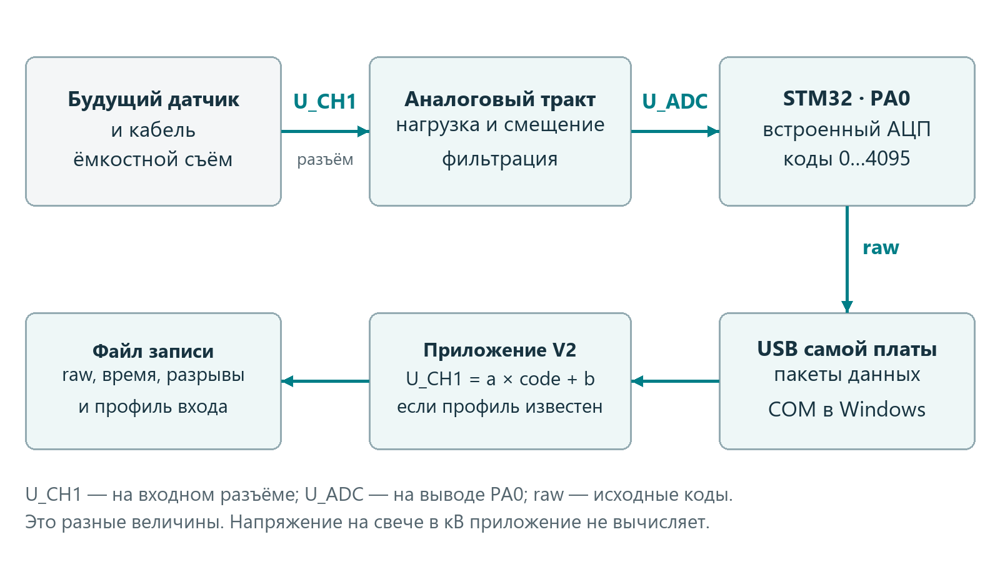
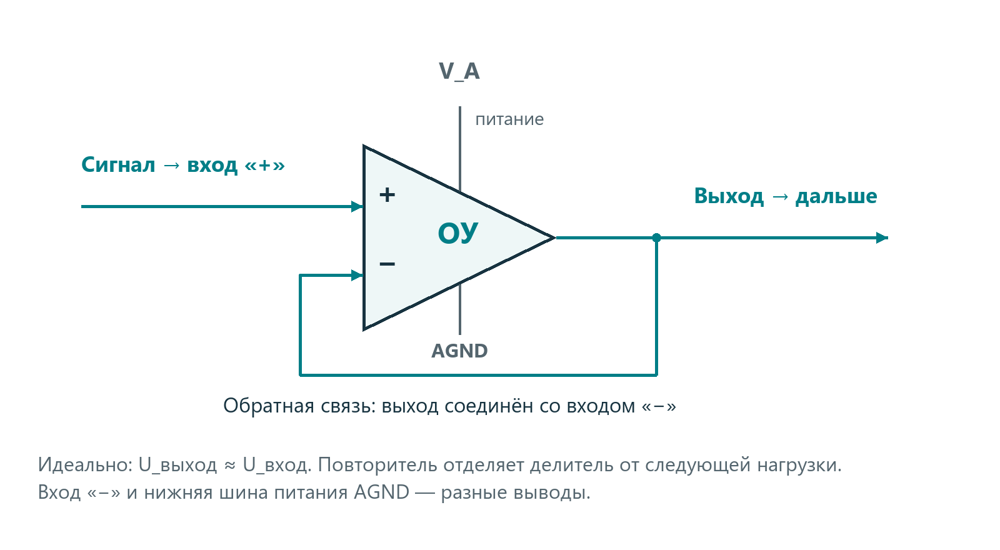
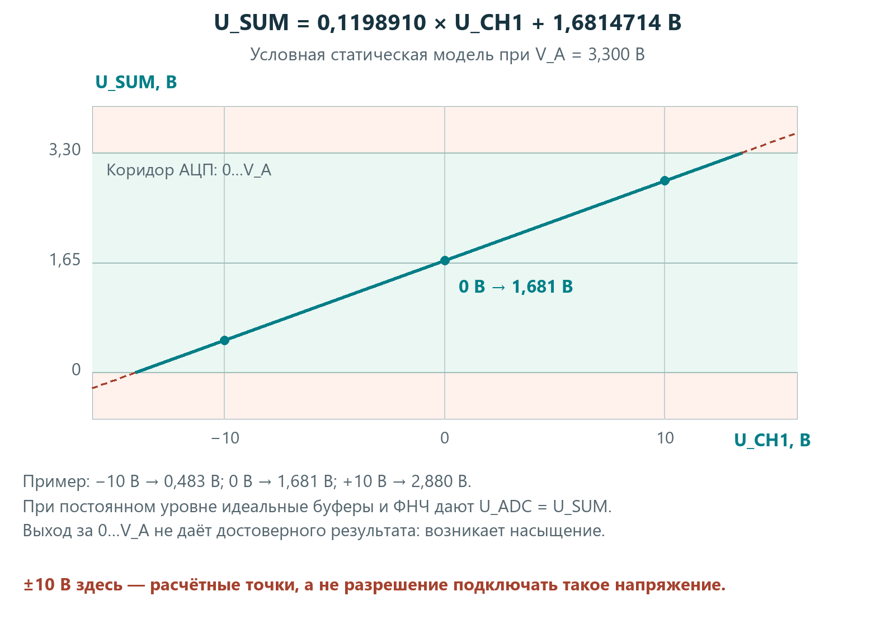
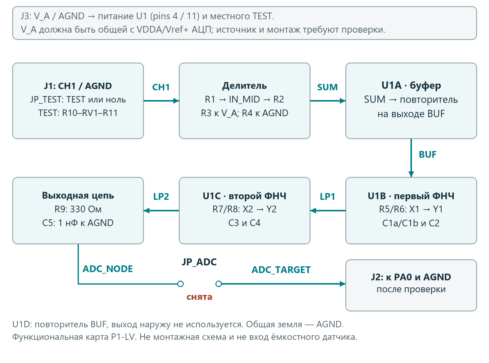
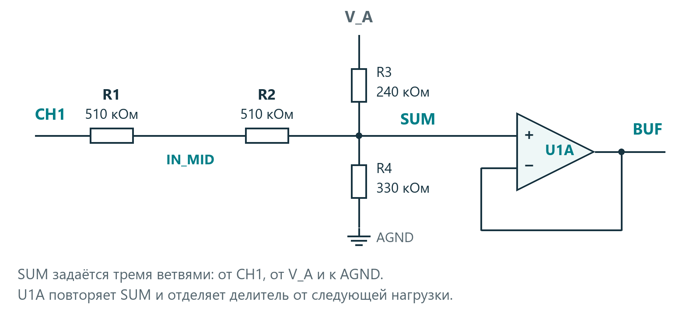
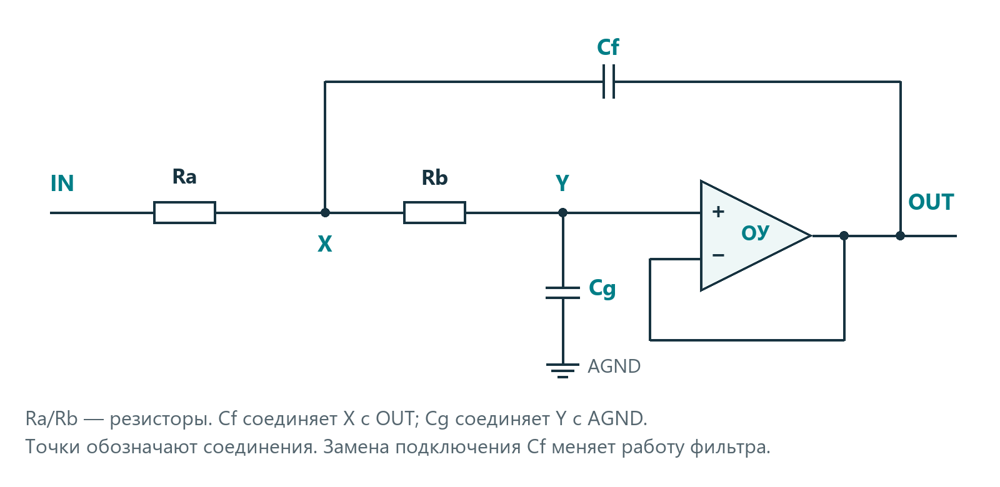
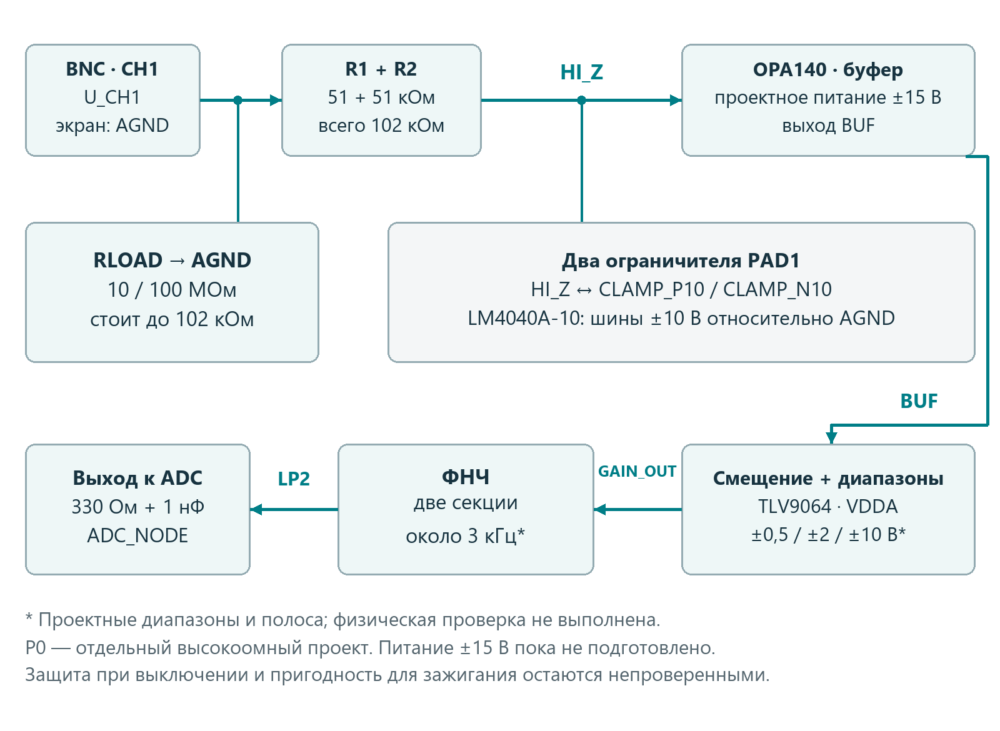

# Как работает вход Мотортестера V2

Учебное руководство по схемам и будущей проверке

Редакция 2 от 21 октября 2026 года. Схема P1-LV r2 с распространёнными номиналами E24 и раздельными требованиями к резисторам 1% и 5%. Для Александра, знакомого с резисторами, конденсаторами, диодами и питанием, но впервые работающего с измерительными усилителями.

Это руководство объясняет, как напряжение становится графиком, зачем между датчиком и STM32 нужна отдельная схема и какую работу выполняет каждая её часть. Основной пример — P1-LV, небольшой лабораторный макет, который можно изучать без датчика зажигания. Затем разобран P0 — более сложный высокоомный вход для будущего ёмкостного датчика.

Сейчас пользователь подтвердил непрерывный приём с платы, сохранение и открытие файла. Аналоговые схемы P1-LV и P0 пока рассчитаны, но не собраны и не проверены физически. Плавающий A0 и появившийся график не подтверждают точность измерения напряжения. Документ описывает устройство и подготовку будущих работ; конкретное подключение питания платы ещё нужно установить.

## Как читать руководство

Сначала прочитайте разделы 1–4: они дают основу для понимания схем. Разделы 5–10 объясняют P1-LV и его соединения, а новые 6а/6б — резисторы и их отбор. Разделы 11–13 показывают будущий датчик и старые варианты. Разделы 14–17 посвящены проверке, калибровке и приложению. В конце есть словарь и источники.

**Три вида сведений.** «Расчёт» означает результат формулы при оговорённых условиях. «Проект» означает выбранный для дальнейшей проверки вариант. «Измерение» означает результат реального опыта. В этом руководстве численные характеристики аналогового входа относятся к первым двум видам.

**Что измеряет V2.** Напряжение между сигнальным контактом CH1 и его сигнальной землёй, в вольтах или милливольтах. Напряжение свечи в киловольтах не вычисляется. Одинаковое имя CH1 в программе и на разъёме не делает эти разные напряжения равными.

## Какие схемы здесь рассматриваются

| Название | Задача | Граница |
|---|---|---|
| P1-LV | Изучить смещение, фильтр и будущую калибровку на местном DC-источнике | Не вход для пассивного датчика зажигания |
| P0 | Исследовать высокоомный вход для будущего ёмкостного датчика | Питание и защита ещё требуют разработки и проверки |
| Старый вариант A | Подать несколько постоянных уровней на АЦП | Местный источник, а не внешний измерительный вход |
| Старый вариант B | Изучить небольшой переменный лабораторный сигнал | Разделительный конденсатор не пропускает DC |

<!-- pagebreak -->

## 1 От напряжения до графика

Будущий датчик получает электрический отклик рядом с изолированным высоковольтным проводом. Кабель передаёт его на CH1. Аналоговый тракт меняет масштаб и положение сигнала так, чтобы напряжение на входе АЦП оставалось в допустимой области. АЦП измеряет его много раз в секунду; прошивка передаёт числа по USB; приложение располагает их на временной оси.

**Аналоговый тракт** — детали от входного разъёма до АЦП. Слово «аналоговый» означает, что внутри этого участка напряжение непрерывно меняется со временем. Числа появляются только после преобразования АЦП.

В схеме есть три разные величины. U_CH1 — напряжение на разъёме. U_ADC — напряжение непосредственно на аналоговом выводе STM32. Raw, или исходный код, — целое число, которое вернул АЦП. Например, нулю на CH1 у P1 соответствует примерно половина питания на АЦП. Поэтому код около 2048 не означает напряжение 2048 мВ.

Два профиля интерфейса, «Осциллограф» и «Зажигание», меняют способ просмотра и набор показателей одного канала. Они не добавляют второй провод и не перестраивают резисторы. Смена масштаба графика тоже не увеличивает допустимое напряжение входа.

**Почему не подать сигнал сразу на A0.** АЦП измеряет относительно своей земли и опоры, а не произвольное положительное и отрицательное напряжение. У конкретной платы нужно подтвердить питание и расположение PA0. Обозначение «5 V tolerant» у цифрового вывода не разрешает подать 5 В в режиме аналогового измерения [3].

<!-- pagebreak -->

## 2 Что важно знать о сигнале

Сигнал — напряжение как функция времени. У батарейки оно почти постоянно. У синусоиды меняется плавно и периодически. Импульс быстро появляется и исчезает. У каждого случая важны не только максимальное напряжение, но и длительность, форма, скорость изменения и постоянная составляющая.

**Постоянная составляющая, или DC.** Представьте колебание от 1 до 2 В. Его средний уровень около 1,5 В, а отклонение от него ±0,5 В. Удалив среднее программой, мы покажем −0,5…+0,5 В, но физическое напряжение на разъёме останется 1…2 В. Поэтому V2 не должен автоматически вычитать DC из измерения CH1.

**Размах** — разница максимума и минимума. В этом примере размах 1 В. **Период** — время полного повторения; **частота** — число повторений за секунду. Период 4 мс соответствует 250 Гц. Для неповторяющегося импульса такой период вообще может отсутствовать.

**Сопротивление источника.** Любой реальный источник меняет выход под нагрузкой. Если его условное внутреннее сопротивление 100 кОм, а прибор подключает 100 кОм к земле, получается делитель: вместо напряжения холостого хода видна примерно половина. При входе 10 МОм влияние в этом простом DC-примере около 1%. Это объясняет желание сделать вход «высокоомным».

У ёмкостного датчика нагрузка ещё и меняет форму во времени. Конденсаторы электрода и кабеля могут быстро зарядиться, а затем разрядиться через входной резистор. Поэтому одинаковый датчик с разными кабелями или входами способен показать разные импульсы.

**Земля AGND** — выбранная общая точка отсчёта напряжений. Она не обязана быть изолирована от компьютера, корпуса осциллографа или защитного заземления розетки. Провода USB, ST-Link и приборные щупы могут соединять эти точки. Перед физическим опытом рассматривается вся установка, а не только сигнальный провод.

<!-- pagebreak -->

## 3 Как работает операционный усилитель

Операционный усилитель, сокращённо ОУ, имеет два сигнальных входа, выход и отдельные выводы питания. Вход «+» называют неинвертирующим, вход «−» — инвертирующим. Это названия реакции усилителя на разность сигналов; знак «−» возле входа не означает минус питания.

Если напряжение на «+» чуть выше напряжения на «−», усилитель стремится поднять выход. Если ниже — опустить. Без дополнительных связей даже маленькая разница может увести выход к пределу питания. Для точной работы часть выхода возвращают на вход «−»: это отрицательная обратная связь.

В **повторителе** выход прямо соединён с «−», а сигнал подан на «+». Усилитель изменяет выход до состояния, когда входы почти равны. В результате U_OUT ≈ U_IN. Энергия для выхода поступает из питания микросхемы; слабый источник на входе задаёт уровень.

Зачем нужен усилитель, который не увеличивает напряжение? Его вход берёт малый ток, а выход может питать следующую цепь. Так он отделяет чувствительный узел от нагрузки. Это называют **буфером**. Если подключить фильтр напрямую к резисторному делителю, фильтр изменит его поведение. Буфер сильно уменьшает такое взаимодействие.

Реальный ОУ не идеален: у него есть небольшая собственная ошибка, ограниченная скорость, допустимый диапазон входов и нагрузок. Выход не обязан доходить точно до шин питания. Слово rail-to-rail означает возможность работать близко к ним при определённых условиях, а не отсутствие ограничений [1].

В P1 выбран TLV9064: четыре ОУ в одном SOIC-14, работа от одной низкой шины, пригодность для повторителя и фильтров. Три секции выполняют основной тракт, четвёртая подключена определённым образом, чтобы не оставить её входы плавающими. LM358 или другой знакомый ОУ нельзя подставить без проверки питания, входов, выхода и устойчивости.

<!-- pagebreak -->

## 4 Зачем уменьшать сигнал и добавлять смещение

Предположим, питание и опора АЦП равны 3,3 В. Он не измеряет отрицательную часть сигнала напрямую. Чтобы перенести сигнал в положительную область, схема уменьшает его и добавляет постоянный уровень около середины питания.

У P1-LV в идеальном установившемся режиме:

**U_ADC = 0,1198910 × U_CH1 + 1,681471 В**

Это расчёт при V_A = 3,300 В. Число 0,1198910 означает ослабление примерно в 8,34 раза. Слагаемое 1,681471 В — смещение. Оба действия выполняются физическими резисторами до первого буфера.

| Напряжение CH1 в расчёте | Установившееся напряжение ADC_NODE | Что произошло |
|---|---|---|
| 0 В | 1,6815 В | Сигнал находится около середины питания |
| 0,4 В | 1,7294 В | Увеличение входа на 0,4 В дало около 0,0480 В на АЦП |
| 0,8 В | 1,7774 В | Ещё такое же приращение |

Эта таблица объясняет математику. Точка 0,8 В не является командой подавать внешнее питание: местный TEST номинально достигает около 0,776 В. На быстрых изменениях между входом и АЦП также действует фильтр, поэтому одной DC-формулы недостаточно для мгновенного значения.

При отображении программа выполняет обратный пересчёт. Смещение графика вверх или вниз — другая операция: она двигает рисунок на экране и не должна подменять физический ноль.

<!-- pagebreak -->

## 5 Общий план макета P1

P1-LV выбран как ближайший учебный шаг, потому что у нас пока нет датчика, кабеля и двуполярного питания. На нём можно изучить общие для будущего прибора узлы: смещение, буфер, фильтр, выход к АЦП и метод определения шкалы. Он не обещает сохранить форму сигнала пассивного датчика.

Входной разъём J1 содержит CH1 и AGND. При первом опыте внешний источник туда не подключается: маленький тестовый сигнал создаётся на самом макете. После резисторов сигнал попадает в SUM, затем в буфер BUF, две секции фильтра LP1 и LP2 и выходную точку ADC_NODE.

Названия SUM, BUF, LP1 — имена электрических узлов, а не отдельные детали. Все точки с одним именем должны быть электрически соединены. Обозначения R, C, U соответствуют резисторам, конденсаторам и микросхемам. J — разъём, JP — место съёмной перемычки, TP — контрольная точка для измерения.

Питание входит через J3: проверенная шина V_A и AGND. Выход к плате проходит через J2. Между ADC_NODE и контактом выхода стоит JP_ADC: съёмная перемычка. **На первой проверке она отсутствует**, поэтому напряжение макета не попадает на PA0.

Разработан электрический чертёж P1, но ещё нет проверенного монтажного расположения деталей и готовой печатной платы. Нельзя считать положение элементов на функциональном рисунке местом, куда их паять. Для монтажа используется перечень сетей и будущая CAD-схема.

<!-- pagebreak -->

## 6 Входные резисторы и первый буфер

Сигнальная цепь начинается так: CH1 → R1 510 кОм → IN_MID → R2 510 кОм → SUM. К SUM также подключены R3 240 кОм от V_A и R4 330 кОм к AGND. R1 и R2 вместе дают 1,02 МОм. Их разбиение на две детали не означает подтверждённую защиту от высокого напряжения.

SUM — точка, где сходятся три резисторные ветви. В идеальном случае вход ОУ почти не отбирает ток, поэтому токи через эти ветви взаимно уравновешиваются. Напряжение SUM получается взвешенной суммой напряжения CH1 и питания. Отсюда возникают ослабление и смещение предыдущего раздела.

Если хочется проверить формулу, сначала объедините R1 + R2 в Rs = 1,02 МОм, а затем запишите:

**U_SUM = (U_CH1 / Rs + V_A / R3) / (1 / Rs + 1 / R3 + 1 / R4)**

Сопротивления подставляются в одинаковых единицах. Член от земли равен нулю. Отношения сопротивлений определяют масштаб; поэтому для R1–R4 предусмотрены допуск 1% и температурный коэффициент не более 25 ppm/°C. Калибровка может уточнить масштаб и ноль, но не исправляет любое изменение параметров при нагреве.

U1A повторяет SUM на выходе BUF. Его вход «+» — вывод 3, «−» — вывод 2, выход — вывод 1. Соединение 1–2 замыкает обратную связь. Фильтр получает сигнал от BUF и меньше влияет на исходный делитель.

**Что происходит с открытым входом.** Если CH1 никуда не подключён, цепь R3/R4 подтягивает его примерно к 1,911 В при V_A = 3,3 В. Поэтому «снять провод» не означает «подать ноль». Для нуля в лабораторном опыте CH1 соединяется с AGND через выбор ZERO.

Со стороны CH1 схема похожа на источник около 1,911 В с последовательным сопротивлением около 1,159 МОм. Она подаёт небольшой ток в подключённый источник и может существенно изменить слабый ёмкостный сигнал. Именно поэтому P1 выделен в самостоятельный учебный макет.

<!-- pagebreak -->

## 6а Какие резисторы покупать

В r2 используем распространённые номиналы E24. Ряд номиналов отвечает на вопрос «какое сопротивление указано на детали», а допуск — «насколько фактическое сопротивление может отличаться». Поэтому обычные 510 кОм можно купить с допуском 1%; для них не обязательно выбирать 5%.

| Где стоят резисторы | Что требуется | Почему |
|---|---|---|
| R1 и R2 по 510 кОм, R3 240 кОм, R4 330 кОм | 1%, TCR ≤25 ppm/°C | Задают ослабление, смещение и нагрузку CH1 |
| R5 и R6 по 4,7 кОм, R7 и R8 по 2 кОм | 1% | Определяют частотную характеристику фильтра |
| R9 330 Ом | 1% | Участвует в выходной цепи перед АЦП |
| R10 33 кОм, R11 1 кОм, R12 10 кОм | 5% с отбором или готовые 1% | TEST всё равно измеряется отдельно; R12 — вспомогательная нагрузка |

У всех постоянных резисторов выбраны металлоплёночное исполнение и мощность 0,25 Вт. Для первой группы важен также малый температурный коэффициент: 25 ppm/°C означает относительное изменение около 0,0025% на один градус в условиях паспорта. Проверка омметром при одной температуре этого свойства не устанавливает.

В основной сборке 12 постоянных резисторов и один RV1. Набирать 499 кОм из последовательных пар теперь не требуется: схема пересчитана под новые значения. Если составная замена позже окажется удобнее по наличию, её сначала проверяют как отдельную замену. Два резистора по 5% не превращаются автоматически в эквивалент 1%.

**Конденсаторы не упрощаем вслед за резисторами.** C1a, C1b, C2, C3 и C4 остаются C0G/NP0 либо плёночными, до 2%, от 25 В. C5 — C0G/NP0, до 2%, от 25 В. Развязка питания C6/C7 имеет другие требования. Полный список корпусов и количеств находится в materials-ru.md.

<!-- pagebreak -->

## 6б Как отобрать резисторы 5 процентов

Подбор нужен только для R10–R12. Покупаем или берём исправные резисторы нужного номинала и измеряем до пайки, по отдельности. Цель — получить показание в пределах ±3% от номинала; схема при этом всё равно рассчитана на полный исходный допуск ±5%.

| Деталь | Диапазон RM102 | Принимаемое показание |
|---|---|---|
| R10 33 кОм | 60,00 кОм | 32,01…33,99 кОм |
| R11 1 кОм | 6,000 кОм | 0,970…1,030 кОм |
| R12 10 кОм | 60,00 кОм | 9,70…10,30 кОм |

Порядок простой: обесточить и отделить деталь от схемы; дать остыть после пайки; установить чёрный щуп в COM, красный в VΩHz и включить измерение сопротивления. RM102 выбирает диапазон автоматически: проверить единицы и разряды, дождаться устойчивого показания. Пальцами не держать одновременно оба металлических вывода. Записать обозначение, номинал, показание и диапазон. На собранной плате параллельные цепи могут занизить результат.

В найденной инструкции RM101/RM102 погрешность сопротивления до 6 МОм указана как ±(0,5% показания + 3 единицы младшего разряда) [8]. Например, для 33,00 кОм на диапазоне 60,00 кОм это ±0,195 кОм: 0,165 кОм плюс 0,03 кОм. Последние цифры дисплея не означают такую же точность.

Правило отбора оставляет запас относительно 5%: даже на краю приведённого окна сумма отклонения показания и паспортной ошибки меньше 4%. Это справедливо, только если инструкция соответствует именно вашему исправному прибору и соблюдены её условия. При другом диапазоне или другой точности границы надо проверить заново.

**Отобранный резистор остаётся деталью 5%.** Он не получает паспортного допуска 1%, малый температурный коэффициент или подтверждённую долговременную стабильность. R1–R9 таким подбором не заменяем. Если R10–R12 не попали в окно, выбираем другие детали либо ставим готовые 1% тех же номиналов; их также проверяем на явную ошибку маркировки.

Измерение сопротивления не проверяет форму импульса, самовозбуждение ОУ или поведение при выключении питания. Эти проверки относятся к готовому макету и выполняются отдельно.

<!-- pagebreak -->

## 7 Как фильтр меняет сигнал

Слишком быстрые изменения и помехи могут попасть в цифровые данные как ложная более медленная форма. Это называется наложением спектров, или алиасингом. Программная обработка после АЦП не всегда может узнать, какой сигнал был до такого наложения. Поэтому часть ограничения частот нужна ещё до преобразования.

**Фильтр нижних частот, ФНЧ**, хорошо пропускает постоянный уровень и медленные изменения, а быстрые ослабляет. Его частота не является «скоростью USB». Частота выборок задаётся прошивкой, а фильтр определяет, какую часть аналогового сигнала мы стараемся передать.

В P1 две активные RC-секции Sallen–Key: резисторы, конденсаторы и ОУ-повторитель [4]. Вместе они дают фильтр четвёртого порядка и сильнее ослабляют высокие частоты, чем одна RC-цепь. Новые номиналы дают частоту −3 дБ двух идеальных секций около 3,086 кГц. Это небольшое изменение относительно r1 сохраняет задачу фильтра около 3 кГц; произвольно быстрые фронты он не передаёт.

| Секция | Резисторы | Конденсатор к выходу своего ОУ | Конденсатор к земле |
|---|---|---|---|
| Первая, U1B | R5 и R6 по 4,7 кОм | C1a 10 нФ и C1b 1,8 нФ параллельно | C2 10 нФ |
| Вторая, U1C | R7 и R8 по 2 кОм | C3 68 нФ | C4 10 нФ |

На рисунке Ra/Rb — два последовательных резистора, Cf — конденсатор к выходу, Cg — конденсатор к земле. Питание ОУ опущено только на этом фрагменте. Цепь имеет вид IN → Ra → X → Rb → Y → вход «+». Перенос Cf на землю даст другую схему, хотя постоянное напряжение может выглядеть правильным.

ОУ помогает задавать форму фильтра и развязывает его от следующей нагрузки. Соотношения ёмкостей задают характер реакции каждой секции. Вторая реагирует на фронт заметнее, поэтому полный фильтр может дать краткий выброс. Номинал 3 кГц не означает, что на 3001 Гц сигнал исчезает.

**Цена фильтрации.** Шум уменьшается, но узкий пик тоже сглаживается и запаздывает. При номинальных 50 тысячах выборок в секунду между измерениями 20 мкс; импульс длиной 10 мкс короче этого промежутка. Нельзя обещать точный пик пробоя по такому тракту. Полосу и скорость для дальнейшей задачи зажигания предстоит проверять по реальному сигналу.

<!-- pagebreak -->

## 8 Выход к АЦП и питание микросхемы

После LP2 установлен R9 330 Ом. За ним находится ADC_NODE; из этой точки C5 1 нФ подключён к AGND. АЦП внутри STM32 на время выборки подключает небольшую ёмкость. Источник должен успеть её зарядить; сопротивление и время выборки влияют на результат [3, 5].

R9 отделяет выход ОУ от ёмкостной нагрузки. C5 служит местным запасом заряда и участвует в выходной RC-цепи. Эти детали не дают права считать выход защищённым от любой ошибки питания. Обратная связь последнего ОУ берётся с LP2, до R9, как указано в netlist.

TLV9064 получает питание V_A на выводе 4 и AGND на выводе 11. Между ними возле корпуса устанавливаются C6 100 нФ и C7 1 мкФ. Короткая местная цепь питания помогает отдавать быстрые изменения тока, не заставляя их идти по длинным проводам. Поэтому расположение этих конденсаторов имеет значение.

R12 10 кОм между V_A и AGND создаёт небольшую нагрузку и помогает разряду. Он не является универсальным ограничителем напряжения или средством поглотить произвольный аварийный ток.

Неиспользованная в главной цепи секция U1D включена повторителем BUF: вывод 12 к BUF, выводы 13 и 14 соединены. Вывод 14 больше никуда не подключён. Нельзя соединять его с другими выходами только потому, что они должны показывать похожее напряжение.

**Откуда взять V_A.** По проекту это та же проверенная шина, которая задаёт питание и опору АЦП. Номинальные 3,3 В — расчётное условие; нужно подтвердить разводку конкретной платы и запас тока. Нельзя соединять параллельно отдельные выходы USB-питания и ЛБП.

Почему отдельно изучаем выключение? Напряжение питания может упасть раньше напряжения на конденсаторе. Тогда сигнал способен оказаться выше уже падающей шины АЦП и вызвать подпитку через внутренние структуры [6]. Проверка только мультиметром во включённом состоянии этого не обнаруживает.

<!-- pagebreak -->

## 9 Местный источник тестового напряжения

Чтобы начать изучение без генератора и датчика, на макете предусмотрен собственный регулируемый DC-уровень. Цепь: V_A → R10 33 кОм → верхний край RV1 10 кОм; нижний край RV1 соединён с AGND. Движок RV1 через R11 1 кОм идёт на TEST.

Вращение винта перемещает движок по резистивной дорожке. R10 уменьшает доступное напряжение. При этом вход P1 немного нагружает источник и сам подаёт в него небольшой ток, поэтому расчёт обычного ненагруженного делителя недостаточен.

| Положение регулятора | Расчётное U_CH1 при 3,3 В | Как использовать |
|---|---|---|
| Нижнее | Около 0,00165 В | Не считать точным нулём |
| Среднее | Около 0,391 В | Одна из будущих контрольных точек |
| Верхнее | Около 0,776 В | Номинал, а не эталонное напряжение |
| Отдельное ZERO | CH1 соединён с AGND | Проверка физического нуля входа |

JP_TEST — три контакта. Средний электрически соединён с CH1, один край с TEST, другой с AGND. Один съёмный колпачок соединяет средний контакт с выбранным крайним. Стороны определяются будущей маркировкой платы: «левый» и «правый» без монтажного чертежа не задаются.

В режиме TEST сигнал идёт от регулятора; в режиме ZERO CH1 замкнут на AGND. Снятый колпачок освобождает J1 для отдельного будущего внешнего опыта. В первом опыте внешний J1 всегда свободен; TEST и ZERO одновременно не соединяются.

Регулятор нужен для изменения уровня, а точное значение измеряется мультиметром на CH1 при подключённом макете. Напряжение на ручке ЛБП или расчётная цифра не заменяют этого измерения. Сам мультиметр тоже нагружает вход; его диапазон и подключение нужно сохранять одинаковыми.

Общая шина у тестового источника и АЦП удобна для проверки цепи, но не делает её независимым эталоном. Если шина изменилась, одновременно изменились и тестовый уровень, и опора измерения.

<!-- pagebreak -->

## 10 Карта соединений P1

Эти таблицы относятся к TLV9064IDR в SOIC-14, виду сверху по паспорту [1]. Сначала найдите ключ первого вывода. На реальном переходнике следует сверить дорожки; вид снизу зеркален. Сигнальные названия ниже соответствуют расчётной схеме, а не номерам контактов неизвестной макетной платы.

| Вывод U1 | Куда подключён | Назначение |
|---|---|---|
| 1 | BUF и вывод 2 | Выход U1A и его обратная связь |
| 2 | Вывод 1 | Вход «−» U1A |
| 3 | SUM | Вход «+» U1A |
| 4 | V_A | Плюс питания |
| 5 | Y1 | Вход «+» U1B |
| 6 | Вывод 7 | Вход «−» U1B |
| 7 | LP1 и вывод 6 | Выход первой секции фильтра |
| 8 | LP2 и вывод 9 | Выход второй секции фильтра |
| 9 | Вывод 8 | Вход «−» U1C |
| 10 | Y2 | Вход «+» U1C |
| 11 | AGND | Минус однополярного питания |
| 12 | BUF | Вход «+» U1D |
| 13 | Вывод 14 | Вход «−» U1D |
| 14 | Только вывод 13 | Выход вспомогательного повторителя |

| Разъём или перемычка | Электрические контакты | Начальное состояние |
|---|---|---|
| J1 | CH1 и AGND | Без внешнего источника |
| J3 | V_A и AGND | Питание только после проверки платы и монтажа |
| JP_TEST | Край TEST, середина CH1, другой край AGND | Один колпачок выбирает TEST либо ZERO |
| JP_ADC | ADC_NODE и ADC_TARGET | Перемычка снята |
| J2 | ADC_TARGET и AGND | После отдельного допуска к подтверждённым PA0 и земле STM32 |

Программа использует PA0/ADC1_IN0. Надпись A0 на плате надо сопоставить с реальным PA0; инструкция не задаёт физическое расположение контактов всех плат Blue Pill. На стороне P1 находится выход, на стороне STM32 — вход АЦП. USB соединяет плату с ПК; ST-Link служит программированию и отладке, а не передаче измеренного сигнала в приложение.

<!-- pagebreak -->

## 10 Продолжение карты соединений

Каждая строка указывает два конца детали. Параллельные C1a/C1b имеют одинаковые концы. Провод между выходом ОУ и входом «−» указан в таблице выводов предыдущей страницы.

| Деталь | Номинал | Первый конец | Второй конец |
|---|---|---|---|
| R1 | 510 кОм · 1% | CH1 | IN_MID |
| R2 | 510 кОм · 1% | IN_MID | SUM |
| R3 | 240 кОм · 1% | V_A | SUM |
| R4 | 330 кОм · 1% | SUM | AGND |
| R5 | 4,7 кОм · 1% | BUF | X1 |
| R6 | 4,7 кОм · 1% | X1 | Y1 |
| C1a и C1b | 10 нФ и 1,8 нФ | X1 | LP1 |
| C2 | 10 нФ | Y1 | AGND |
| R7 | 2 кОм · 1% | LP1 | X2 |
| R8 | 2 кОм · 1% | X2 | Y2 |
| C3 | 68 нФ | X2 | LP2 |
| C4 | 10 нФ | Y2 | AGND |
| R9 | 330 Ом · 1% | LP2 | ADC_NODE |
| C5 | 1 нФ | ADC_NODE | AGND |
| R10 | 33 кОм · 5%* | V_A | Верх RV1 |
| RV1 | 10 кОм | Верх после R10 | Низ к AGND; движок к R11 |
| R11 | 1 кОм · 5%* | Движок RV1 | TEST |
| R12 | 10 кОм · 5%* | V_A | AGND |
| C6 и C7 | 100 нФ и 1 мкФ | V_A | AGND |

*R10–R12 отбираются по разделу 6б; готовые 1% тех же номиналов также подходят. RV1 — 10 кОм, многооборотный линейный, до 20%; он не входит в 12 постоянных резисторов.

Контрольные точки: TP0 — AGND; TP1 — CH1; TP2 — SUM; TP3 — BUF; TP4 — LP1; TP5 — LP2; TP6 — ADC_NODE; TP7 — V_A.

Начальные DC-проверки удобнее проводить на BUF, LP1 и LP2. Подключение измерительного прибора прямо к высокоомному SUM меняет нагрузку и способно исказить проверяемый режим. Сначала выясняются характеристики щупа и мультиметра.

На схеме P1 обозначения U1A…U1D относятся к одной TLV9064. У P0 нумерация другая: U1 — OPA140, U2 — TLV9064. Смешивать номера деталей разных вариантов нельзя.

<!-- pagebreak -->

## 11 Как будет работать ёмкостный датчик

Будущий самодельный датчик предполагает электрод рядом с изолированным высоковольтным проводом. Электрод и провод образуют маленькую ёмкость. Изменяющееся напряжение вызывает через неё ток; кабель и вход преобразуют этот ток в наблюдаемое напряжение. Постоянное напряжение через такую связь в установившемся режиме не передаётся.

Экран кабеля и вход имеют собственную ёмкость. Чем она больше относительно связи с проводом, тем меньше может быть полученный скачок. Входное сопротивление определяет скорость дальнейшего разряда. Поэтому кабель — часть измерительной цепи, а не произвольный удлинитель.

Для простого объяснения можно взять условные ёмкости связи 1 пФ и нагрузки 200 пФ. Это вымышленные параметры модели, не измерения будущего датчика. При нагрузке 100 МОм характерное время разряда получается около 20 мс; при 1,159 МОм — около 0,23 мс. За несколько миллисекунд формы заметно разойдутся. Полный реальный датчик сложнее этой RC-модели.

**Почему выбрано исследовать 10 и 100 МОм.** Такие нагрузки помогают изучить компромисс между сохранением медленной части отклика и чувствительностью к утечкам, помехам и загрязнению. Большее сопротивление не всегда лучше. Оно требует чистого монтажа и малых токов входа и защиты.

На предполагаемом BNC центральный контакт — CH1, наружный экран — AGND. Наличие BNC не означает, что нужно ставить терминатор 50 Ом: он резко изменит нагрузку датчика. Геометрия электрода, длина кабеля, фактические ёмкости и допустимая изоляция пока не определены.

Первое изучение конструкции будет без зажигания: отдельный образец изолированного провода, отсоединённый кабель, измерение ёмкостей с учётом показания разомкнутых щупов. Если прибор не различает малую ёмкость, результат записывается как неопределённый, а не как ноль. Такой опыт не подтверждает высоковольтную прочность.

DC-связь самого мотортестера сохраняет постоянный уровень на CH1. Она не восстанавливает постоянную составляющую вторичного напряжения, которую не передал ёмкостный датчик. Коэффициент пересчёта в киловольты в проект не входит.

<!-- pagebreak -->

## 12 Будущий высокоомный вход P0

P0 задуман для исследования слабого ёмкостного источника. Он отделяет высокоомный вход от схем смещения и фильтрации. По сложности это следующий самостоятельный проект: требуются дополнительные шины питания, проверка утечек и защиты.

Нагрузка RLOAD подключена от CH1 к AGND перед двумя последовательными резисторами по 51 кОм. Она задаёт 100 МОм по умолчанию, либо исследуемые 10 МОм; вариант 200 МОм остаётся исследовательским. В каждый момент выбирается одна нагрузка. Эти резисторы и два по 51 кОм выполняют разные функции.

После 102 кОм находится чувствительный узел HI_Z и ОУ OPA140, включённый повторителем. Он выбран как кандидат с малым входным током. Проект использует питание +15 В и −15 В относительно AGND, чтобы исследовать положительный и отрицательный сигнал. Питание 3,3 В для OPA140 не подходит [2].

Два малотоковых диода PAD1 направляют чрезмерное отклонение HI_Z к опорным шинам около +10 и −10 В. Шунтирующие источники LM4040A-10 с подпиткой через 10 кОм формируют эти шины. Шунт способен принять ток в предусмотренном режиме, но вся цепь ещё не проверена на импульсы и потерю питания. Диод не является идеальным выключателем ровно на 10 В: порог зависит от тока и условий.

Малый ток утечки принципиален. Даже условные 5 нА через 100 МОм дают 0,5 В. Поэтому подходящий по внешнему виду диод не обязательно пригоден для такого входа. В реальной схеме учитываются также плата, грязь, влажность, разъём и изоляция.

<!-- pagebreak -->

## 12 Продолжение схемы P0

Локальное охранное кольцо, guard, получает потенциал BUF через 1 кОм и уменьшает разность напряжений возле чувствительного узла. Это отдельная конструктивная мера. Экран BNC остаётся на AGND; подключать экран к guard по созвучию нельзя. Ёмкость кольца и устойчивость буфера тоже требуют проверки.

За OPA140 следует преобразование к области АЦП. Делитель 20 кОм / 20 кОм и повторитель U2A создают VMID около половины VDDA. Это опорный уровень для усиления относительно середины диапазона, а не отдельная земля для всей установки.

В SUM P0 сходятся R3 100 кОм от BUF, R4 24,9 кОм от VDDA и R5 33,2 кОм к AGND. Названия и номера относятся к P0. Значения похожи по отношениям на вход P1, но здесь делитель получает сигнал от высокоомного буфера.

U2B усиливает отклонение SUM относительно VMID. Постоянный резистор обратной связи 190 кОм соединяет выход GAIN_OUT с входом «−» FB. Второй резистор Rg соединяет FB с VMID: разрыв, 47,5 кОм или 10 кОм дают усиление 1, 5 или 20. Формула для двух конечных сопротивлений: K = 1 + 190 кОм / Rg.

Так исследуются ориентиры широкого, среднего и чувствительного диапазонов, условно ±10 / ±2 / ±0,5 В на CH1. **Это расчётные ориентиры, не разрешённые пределы готового прибора.** Допустимый вход определяется не одной формулой: нужны запасы ОУ, переходные процессы, защита и проверка всех состояний питания.

Постоянная обратная связь сохраняется между положениями переключателя. Переключать предполагается после остановки захвата; затем дождаться установления и выбрать соответствующий физический профиль. Программа сейчас не распознаёт этот аппаратный переключатель.

После усиления идут две секции Sallen–Key той же топологии и выход 330 Ом / 1 нФ. У P0 они занимают U2C/U2D и сохраняют собственные номиналы: по 4,87 кОм и по 2,03 кОм. Связи деталей приведены в отдельном netlist P0; новые номиналы P1 r2 и его номера выводов сюда не переносятся.

Откуда получить ±15 В при одном ЛБП? Возможен отдельный преобразователь DC/DC, который создаёт две шины. Это вариант для дальнейшего выбора с проверкой запуска, шума и земли. «Середина» из двух резисторов не заменяет рассчитанное питание при USB-соединении. Изоляция одного преобразователя не изолирует всю установку, если USB или осциллограф соединяют её землю с ПК.

<!-- pagebreak -->

## 13 Почему не использованы старые схемы A и B

В исходных материалах уже были лабораторные схемы. Они полезны для отдельных опытов, но решают другие задачи. Наличие готового файла KiCad не доказывает физическую проверку.

**Вариант A** создаёт несколько постоянных уровней от той же шины, что питает АЦП. Четыре последовательных резистора по 1 кОм дают отводы примерно ¼, ½ и ¾ питания. Выбранный уровень через 1 кОм идёт на ADC_IN, где 10 нФ подключены к земле. Диоды BAS70 ограничивают узел относительно шин в предусмотренной схеме.

Это понятный источник для проверки кодов. К нему нельзя подсоединить внешний датчик как к универсальному входу. Общая опора и резисторы 1% также не делают его независимым средством калибровки. Выходы A, B и P1 не соединяются между собой.

**Вариант B** принимает известный небольшой переменный лабораторный сигнал. Его начало: LV_INPUT → конденсатор 1 мкФ → 10 кОм → BIAS_SIGNAL. Резистор 100 кОм соединяет BIAS_SIGNAL с VBIAS, конденсатор 2,2 нФ — с землёй. Одна секция TLV9062 формирует буфер VBIAS от делителя 10 кОм / 10 кОм; другая повторяет сигнал.

После повторителя стоят 1 кОм и 10 нФ на выходе. Есть диодные ограничители и конденсаторы питания. Но входной 1 мкФ не пропускает DC: после установления постоянный внешний уровень исчезает из показания. Передача зависит от частоты и нагрузки; 100 кОм также сильно нагружают слабый ёмкостный источник.

Выбор P1 позволяет на простом местном источнике изучить DC-путь и общие узлы будущего входа. P0 нужен для отдельной высокоомной задачи. Это не последовательное подключение всех схем: каждый вариант имеет собственную область и набор соединений.

DiSco2 использован как ориентир по идее аппаратных диапазонов и DC/AC-связи. Официальная справка Motor-Master не публикует полную принципиальную схему его входа. Наши схемы не являются её копией и не наследуют характеристики коммерческого прибора [7].

<!-- pagebreak -->

## 14 Как будут выполняться работы

Работы идут по этапам, чтобы ошибка в одном узле не скрывалась за красивым графиком. Изготовление датчика не требуется для первого местного DC-опыта. Действующая подробная методика хранится в docs/bench.md.

**Подготовка деталей и монтажа.** Сверяем конкретные модели, корпус TLV9064, допуски и диэлектрики. R10–R12 с допуском 5% отбираем до пайки по разделу 6б. Переносим соединения в редактируемую электрическую схему, проверяем выводы и соединения, затем готовим монтаж. Формальная электрическая проверка схемы называется ERC; она обнаруживает часть ошибок соединений, но не доказывает правильную аналоговую характеристику.

**Проверка без питания.** Осматриваем пайку, ориентацию микросхемы и переходник, прозваниваем нужные связи, ищем непредусмотренные замыкания. JP_ADC снята. Номиналы резисторов проверяем с учётом того, что параллельные ветви на собранной плате могут изменить показание омметра. Омметр не подключаем к запитанной цепи.

**Установление питания.** Выясняем на конкретной STM32-плате источник VDDA и AGND, возможность питания макета и пути земли через USB/ST-Link/приборы. Проектный резерв тока для макета должен быть проверен, а не угадан по надписи Blue Pill. После этого определяется конкретный способ включения.

**Первое включение без связи с ADC.** При разрешённом питании и пустом внешнем J1 измеряем V_A, ток потребления и уровни ZERO/TEST. Неожиданный нагрев, ток или напряжение — причина выключить питание и найти ошибку. Появление около 1,68 В на выходе при нуле CH1 и питании 3,3 В — только проверка правдоподобия DC.

**Проверка осциллографом.** До соединения с A0 исследуем пуск, выключение, неподвижные уровни и переходы TEST/ZERO. Мультиметр усредняет быстрые изменения и может показывать нормальное число при самовозбуждении. Университетский осциллограф нужен именно для закрытия этого пробела.

**Связь с ADC после отдельного допуска.** Если выход соблюдает допустимые границы во всех проверяемых состояниях, установку обесточиваем, устанавливаем JP_ADC и соединяем J2 с подтверждёнными PA0/AGND. Далее проверяем исходные коды, записываем контрольные точки и разрабатываем применение реальной калибровки в приложении.

<!-- pagebreak -->

## 15 Что измерять и как понимать результат

На первом DC-опыте выбираются ZERO и несколько положений TEST. Для каждой точки записываются реальное напряжение CH1, питание V_A, BUF, LP1, LP2 и ADC_NODE. Установившиеся уровни после буфера должны быть близки друг к другу, но точное допустимое отклонение зависит от компонентов и измерителя.

В действующей методике для первых статических точек принят грубый признак отсутствия явной ошибки: выход отличается от расчёта не более чем на 50 мВ плюс неопределённость контрольного измерения. **Это не заявленная точность прибора и не основание пропускать проверку осциллографом.**

| Наблюдение | Возможное объяснение | Следующее действие |
|---|---|---|
| При ZERO выход близок к половине питания | Смещение работает правдоподобно | Проверить TEST и переходы |
| С открытым CH1 напряжение не нулевое | Входной делитель подаёт собственное смещение | Для нуля выбрать ZERO |
| После вращения RV1 уровень не меняется | Ошибка выбора JP_TEST, движка или проводов | Проверить соединения без питания |
| Один из выходов близок к шине питания | Ошибка обратной связи, питания либо перегрузка | Остановить опыт, не подключать A0 |
| Мультиметр показывает норму, осциллограф — быстрые колебания | Возможны самовозбуждение или проблемы монтажа | Исправить до подключения ADC |
| Коды упираются в 0 или 4095 | Возможен выход за измеряемую область или неисправность | Проверить физический уровень, не исправлять масштабом графика |

Осциллограф проверяет V_A и буферные выходы, включая ADC_NODE, при включении и выключении. До опыта выясняем, куда электрически подключён зажим земли щупа. Он может быть связан с защитной землёй розетки и замкнуть точки, которые мы считали независимыми.

До подключения АЦП выход должен оставаться внутри 0…фактической VDDA с запасом на неопределённость измерения в установившихся и проверяемых переходных режимах. Выход за границу требует исправления схемы. Внутренние защитные структуры MCU не используются как штатный ограничитель.

Ручное переключение TEST/ZERO дребезжит. Оно помогает увидеть опасный выброс, но не заменяет известный генератор для измерения полосы. Записываем условия, прибор, щуп и реальные результаты в журнал; расчётные числа не заносим в графу измерений.

<!-- pagebreak -->

## 16 Как АЦП превращает напряжение в число

12-разрядный АЦП имеет 4096 возможных кодов, от 0 до 4095. Для простого идеального расчёта координата кода равна U_ADC / Vref × 4096, с ограничением сверху. Реальный код целый; переходы между кодами, шум и ошибки прибора не сводятся к этому выражению [3].

При условной опоре 3,3 В один шаг составляет около 0,806 мВ на выводе АЦП. P1 предварительно уменьшает сигнал, поэтому на CH1 одному коду соответствует примерно 6,72 мВ. Это цена широкого масштаба. Размер шага не равен точности: прибор может иметь смещение, шум и другие ошибки.

Точки 0 / 0,4 / 0,8 В на CH1 дают в идеальной арифметике координаты около 2087,1 / 2146,6 / 2206,1. Дробные коды здесь лишь результат формулы. Настоящий АЦП их не выдаёт. Автоматически считать код 2048 точным нулём CH1 нельзя.

**Калибровка** определяет связь между реальным напряжением и кодом. Для двух измеренных точек (c1, U1) и (c2, U2):

Выбираются устойчивые, достаточно разнесённые точки без насыщения входа, ОУ и АЦП. Средние коды должны различаться: c2 ≠ c1; иначе делить на их разность нельзя.

**a = (U2 − U1) / (c2 − c1)**

**b = U1 − a × c1**

**U_CH1 = a × code + b**

Здесь a имеет единицы В/код, b — В. Это единственный физический пересчёт в интерфейсе V2. Профиль хранит происхождение коэффициентов и условия, при которых они получены. Исходные коды сохраняются отдельно.

Например, если в учебном примере мультиметр дал 0,000 и 0,600 В при средних кодах 2050 и 2143, получаются a ≈ 0,0064516 В/код и b ≈ −13,2258 В. Эти числа вымышлены для объяснения и не должны переноситься в профиль настоящей платы. Большой отрицательный b лишь компенсирует аппаратное смещение.

После подгонки нужны дополнительные контрольные точки, которые не использовались для вычисления a и b. Иначе мы только проверим формулу на её собственных исходных данных. Нужно также учитывать точность мультиметра, изменение питания, шум и одинаковое подключение измерительных приборов.

Калибровка DC не восстанавливает срезанный пик и не отменяет искажение фильтра. На текущем физическом потоке используется неизвестный входной профиль; применение измеренной калибровки требует отдельного программного этапа.

<!-- pagebreak -->

## 17 Что делают прошивка и приложение

Прошивка организует регулярные выборки АЦП и передачу блоков по USB. Компьютер принимает их, сохраняет исходные отсчёты и строит график. Пакет передачи и видимый участок экрана — технические части этой цепочки, а не отдельные искры.

При номинальной частоте 50 000 отсчётов в секунду расстояние между соседними выборками 20 мкс. Старое окно из 2048 отсчётов охватывало 40,96 мс выборочного времени; между первым и последним моментами 40,94 мс. Непрерывная запись складывается из последовательно принимаемых блоков и не ограничена таким окном. Реальная точность временной шкалы ещё требует независимого измерения.

**Запуск, или триггер**, выбирает удобный момент сигнала, например пересечение заданного уровня по нарастающему фронту. Предыстория — данные до этого момента. Триггер не создаёт физическую искру. Пауза просмотра фиксирует экран; остановка записи прекращает сохранение. Эти действия различаются.

В приложении V2 рабочий путь потока начинается с «Непрерывный приём · STM32», выбора порта и «Подключить». После ответа устройства пользователь явно включает флажок служебных кодов АЦП и отдельно нажимает «Живой поток». «Начать запись» выбирает файл, «Остановить» завершает запись. Потоковый файл .mtstream хранится вместе с сопровождающим .v2.json.

Пока физическая калибровка неизвестна, коды честнее неподтверждённых вольтов. Профиль «Зажигание», новое имя канала или вертикальный сдвиг графика не меняют это ограничение. ДЕМО содержит искусственные данные и не проверяет аналоговые детали.

Разрыв передачи должен оставаться видимым разрывом или предупреждением. Он не означает, что в двигателе отсутствовал разряд. Курсоры A и B показывают разность времени выбранных точек; эта разность сама по себе не доказывает длительность горения. Номер найденного события не является номером цилиндра.

Текущий протокол может подтвердить штатный Stop, сохранив неизвестную полноту последнего хвоста. Поэтому сообщение «Остановлено по команде · полнота хвоста неизвестна» имеет смысл даже при открывающемся файле. Оно описывает данные, а не поломку входного усилителя.

<!-- pagebreak -->

## 18 Что подготовить следующим

Первое действие — выбрать доступные детали по подробному списку materials-ru.md и проверить их паспорта. Не требуется сразу покупать датчик, кабель, ±15 В или компоненты P0. Сначала определяется состав одного P1-LV и способ его аккуратного монтажа.

Для продолжения понадобятся точные товары TLV9064IDR и переходника, доступные резисторы и конденсаторы, сверка найденной инструкции с вашим RICHMETERS 102 и сведения о конкретной STM32-плате. Для R10–R12 запишите результаты отбора. После этого можно выпускать монтажное руководство с расположением контактов и конкретным питанием.

Если удалось прочитать документ, но остались сомнения в соединении, удобно назвать узел: например, «почему C3 идёт на LP2» или «куда подключён средний контакт JP_TEST». Это позволит уточнить конкретную цепь, не переделывая всё описание.

## Короткий словарь

| Термин | Значение в нашем проекте |
|---|---|
| CH1 | Один физический измерительный канал |
| AGND | Общая сигнальная точка отсчёта |
| V_A и VDDA | Шина макета и питание аналоговой части MCU; проект требует проверенной общей шины |
| ОУ | Операционный усилитель с двумя входами и выходом |
| Обратная связь | Возврат выхода на вход для управления поведением ОУ |
| Буфер | Каскад, который уменьшает влияние нагрузки на источник |
| Смещение | Добавление постоянного напряжения |
| ФНЧ | Фильтр, ослабляющий быстрые изменения и высокие частоты |
| Полоса | Область частот с оговорённой передачей, а не частота USB |
| АЦП | Преобразователь напряжения в цифровые коды |
| Опора Vref | Напряжение, относительно которого АЦП задаёт масштаб |
| Насыщение | Уход каскада к пределу, после которого форма искажается |
| Калибровка | Определение связи кода и измеряемого напряжения по реальным точкам |
| Netlist | Перечень, какие электрические точки соединены деталями |
| TBD | Ещё не определено; перед зависимым этапом требуется выяснить |

<!-- pagebreak -->

## 19 Источники и связь с проектом

Численные примеры P1 и P0 основаны на собственных расчётах репозитория, а не на измерениях готового входа. Паспорта подтверждают свойства компонентов в своих условиях; они не подтверждают характеристики всей конструкции.

1. TI TLV9064, SBOS839N Rev N. Корпус, выводы, питание и условия работы ОУ. https://www.ti.com/lit/ds/symlink/tlv9064.pdf

2. TI OPA140, SBOS498F. Основания выбора высокоомного буфера и требования к питанию. https://www.ti.com/lit/ds/symlink/opa140.pdf

3. ST STM32F103x8/xB, DS5319 Rev 20. АЦП, опора, аналоговый вход и электрические условия. https://www.st.com/resource/en/datasheet/stm32f103c8.pdf

4. TI Analysis of the Sallen Key Architecture, SLOA024B. Принцип активного фильтра. https://www.ti.com/lit/an/sloa024b/sloa024b.pdf

5. ST AN2834. Влияние источника, выборки, питания и опоры на АЦП. https://www.st.com/resource/en/application_note/an2834-how-to-optimize-the-adc-accuracy-in-the-stm32-mcus-stmicroelectronics.pdf

6. TI SLVAEX7A. Подпитка цепей при разных состояниях питания. https://www.ti.com/lit/an/slvaex7a/slvaex7a.pdf

7. Motor Master DiSco2. Официальное описание режимов осциллографа. https://motor-master.ru/downloads/help/osc.htm

8. RM101/RM102 User Manual. Пределы и погрешность измерения сопротивления; публичная копия инструкции. Применимость к конкретному прибору пользователя требуется сверить. https://uelectronics.com/wp-content/uploads/2022/11/RM102-English.pdf

## Где находятся основные документы

| Что нужно найти | Путь от корня репозитория |
|---|---|
| Подробные материалы P1 | hardware/v2-input/p1-lv/materials-ru.md |
| Исходные соединения P1 | hardware/v2-input/p1-lv/netlist.md |
| Полный расчётный чертёж P1 | hardware/v2-input/p1-lv/schematic.svg |
| Соединения P0 | hardware/v2-input/netlist.md |
| Старые лабораторные схемы | hardware/analog-source/README_RU.md |
| Формулы и допущения | docs/architecture.md |
| Действующая методика работ | docs/bench.md |
| Условия физической приёмки | docs/validation.md |
| Первичные источники компонентов | docs/sources.md |
| Фактический прогресс | docs/progress.md |

Руководство объясняет действующие сведения и не заменяет их основные места хранения. При будущих изменениях схемы соединения и формулы сверяются с новой версией netlist и architecture. Внешние ссылки позволяют проверить основания; для чтения самого документа интернет не требуется.
