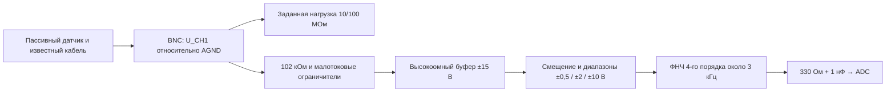

# Измерительный вход CH1 — P0 и лабораторный P1-LV

**Расчётные проекты, не готовая PCB и не разрешение подключать зажигание.**
P0 (HW-V2-01) исследует высокоомный вход; P1-LV (HW-V2-02) — отдельный
низковольтный макет для проверки DC-тракта без датчика. Приоритет задания —
самодельный пассивный ёмкостный бесконтактный датчик; его и кабеля ещё нет.
Разъём BNC предлагается по описанию «как в осциллографах». Требования —
[TXT §4А](design/motortester_alt_prompts.txt), [V2-U01–U10](../requirements.md),
физическая приёмка — [validation.md](validation.md).
Фактические результаты — только в [progress.md](progress.md).

Измеряем U_CH1 между сигнальным контактом разъёма и явно указанной сигнальной землёй. Для источника с большим выходным сопротивлением, особенно ёмкостного датчика, результат зависит от входной нагрузки/кабеля; условия подключения относятся к измерению. Собственный тракт прибора компенсируется; внешние коэффициенты кВ/бар/А и делитель до разъёма не применяются.

## Доступное оборудование и ближайший шаг

Условия пользователя: есть паяльник и опыт пайки, мультиметр и измеритель ёмкости,
сообщена модель «rich-meters 102» (точная инструкция/второй прибор TBD), один ЛБП примерно
0…20 В; двуполярного источника нет. Осциллограф доступен в университете с
затруднениями. Модели, точность/разрешение приборов, связь ЛБП с защитной землёй
и наличие генератора — TBD. Ни ±15 В, ни диапазон ±10 В этим набором не подтверждены.

**Сейчас, пока нет кабеля:** подготовить P1-LV по разделу ниже и паспорт
компонентов/приборов. Измерение ёмкости пока невозможно и не требуется
для схемы местного низковольтного DC-источника.

**После появления кабеля — без питания, MCU и зажигания:** выбрать кабель и сделать
съёмный электрод на отдельном образце изолированного провода. Не использовать
подключённый к автомобилю провод. Записать длину/геометрию, модель измерителя,
показание разомкнутых щупов и ёмкость центральная жила–экран полностью
отсоединённого кабеля. Затем оценить ёмкости макета электрод/внутренняя жила/экран
по [трём измерениям](architecture.md#измерение-ёмкостей-без-питания).
Если малая ёмкость неразличима на фоне разрешения и паразитики, результат —
«не определена данным прибором», а не ноль и не подстановка 1 пФ из примера.
Этот опыт не определяет прочность изоляции или напряжение выхода при зажигании.

## P1-LV: ближайший проект без датчика

| Вариант | Возможность | Существенная цена решения |
|---|---|---|
| P0 с локальным преобразователем от одиночного питания | Сохраняет высокоомный буфер и изучение 10/100 МОм | Нужны проект/проверка ±15 В, шума, пуска, защиты и утечек |
| P1-LV с однополярным питанием | Проверка DC-смещения, фильтра и калибровочной цепочки на местном источнике | Около 1,14 МОм и ненулевой DC-подпор; непригодность как прямой замены P0 |
| Активный буфер у электрода | Может уменьшить влияние длинного кабеля на электрод | Питание/защита/изоляция у датчика и неизвестные параметры конструкции |

Для ближайшего макета выбран **P1-LV**: входной сумматор на резисторах,
TLV9064 на общей с ADC проверенной шине около 3,3 В, прежний расчётный ФНЧ
около 3 кГц, выход через 330 Ом/1 нФ. Первоначально соединение с PA0 разомкнуто.
Местный источник от той же шины даёт небольшой положительный DC-уровень;
датчик, BNC-кабель, двуполярный ЛБП и генератор для проверки этих DC-точек не нужны.
Подключение самого макета к питанию всё равно требует паспорта платы/монтажа.

Соединения, схема, перечень деталей и пустой журнал —
[P1-LV](../hardware/v2-input/p1-lv/README.md).
Это ограниченный лабораторный шаг, а не отказ от P0 или уменьшение целевых
требований к датчику. Общие фильтр/выход/метод калибровки полезны обоим проектам.
Не обещается, что 1,14 МОм сохранят форму пассивного ёмкостного съёма.

Разомкнутый P1-LV подтягивает CH1 примерно к 1,886 В; при CH1=0 отдаёт
около 1,65 мкА в источник. Проверять ноль нужно замыканием CH1 на AGND
в допустимой лабораторной схеме, а не снятием кабеля. Измеряется реальный
U_CH1 с этой нагрузкой. Цифровое удаление среднего не устраняет её физический эффект.

Прежнее предложение «переработать всё под одиночное питание» уточнено:
однополярный **внешний** источник также может питать будущий DC/DC с двумя
шинами для P0. Просто заменить ±15 В на 3,3 В у OPA140 нельзя.
Датчик и окончательный вход проектируются совместно после получения
информации о ёмкостях/нагрузке/сигнале; P1 этого измерения не подменяет.

## Что есть в унаследованных материалах

[Лабораторный аналоговый пакет](../hardware/analog-source/README_RU.md) содержит расчётные кандидаты, не универсальный готовый вход:

- A — локальные DC-уровни от той же VDDA для проверки ADC. Не подтверждает работу произвольного внешнего датчика.
- B — AC-связь через 1 мкФ, смещение около VDDA/2, расчётный лабораторный сигнал −0,5…+0,5 В. DC не проходит; передача зависит от частоты. Диапазон/полоса/защита не подтверждены измерением.

Поэтому ни показ в вольтах, ни эти схемы не разрешают подключение датчика 0,5–4,5 В, отрицательного напряжения или зажигания непосредственно к ADC. Числа макетов и диапазоны Disco2 не параметры нашего тракта. Метаданные исходного wire не дают достаточного набора Vref/G/bias/coupling/calibration для автоматического U_CH1; профиль конфигурации не заменяет эти значения.

Референс — **Motor-Master DiSco2**, а не Autoscope. Официальная справка описывает аппаратные поддиапазоны и микрореле, шунтирующее разделительный конденсатор. Она не раскрывает принципиальную схему, номиналы или защиту входа. Для V2 заимствован принцип независимых диапазонов и DC-связи; числа другого прибора не присваиваются нашему. [Motor-Master](https://motor-master.ru/downloads/help/osc.htm).

## Расчётный макет P0 после решения питания

Цель — исследовать **напряжение на нагруженном BNC**, сохраняя DC-связь самого прибора. Пассивная ёмкостная связь датчика всё равно не передаёт неизвестную постоянную составляющую вторичной цепи. Вычисление кВ и восстановление «истинного» напряжения свечи не выполняются.

Нагрузка подключена от центрального контакта BNC к AGND; экран BNC — AGND, **не** активный guard. Терминатора 50 Ом нет. До автоопытов земля и питание должны быть рассмотрены вместе с USB, SWD, генератором и контрольным осциллографом. Бесконтактный съём сам по себе не означает гальваническую развязку.

| Узел | Предложение для макета | Почему / граница |
|---|---|---|
| BNC и кабель | Панельный BNC с изолированным креплением; один фиксированный кабель, длину и ёмкость измерить | Конкретная модель разъёма/кабеля ещё не выбрана; ёмкость входит в модель датчика |
| Нагрузка | 10 МОм / 100 МОм, ручная смена только без сигнала; исследовательская опция 200 МОм | Начальная рабочая гипотеза — 100 МОм. 200 МОм не «лучше всегда»: больше влияние утечек, влажности и наводок |
| Резисторы нагрузки | Семейство Vishay CRHV, например 100 МОм в 1206; для 200 МОм два 100 МОм последовательно | Точный MPN/допуск/температурный и напряженческий коэффициенты согласовать до монтажа; сопротивление измерить. Это не закупочный BOM |
| Ограничение тока | Два последовательных 51 кОм перед входом буфера | Номинальная сумма 102 кОм; рабочее напряжение/импульсная энергия конкретного корпуса ещё требуют проверки |
| Буфер U1 | OPA140 в SOIC-8, повторитель, проектное питание ±15 В | При этих шинах ±10 В укладывается в паспортный common-mode. Нужного питания пока нет; условие для будущего макета, не характеристика имеющейся установки |
| Ограничители D± | Два PAD1 TO-72 к выделенным ±10 В; кандидатные шунты LM4040A-10 с подпиткой через 10 кОм от ±15 В | Ограничители имеют отдельный путь тока в AGND, не в VDDA/USB. Прототип защиты и переходные режимы пока не проверены |
| Смещение/усиление | TLV9064, питание от той же проверенной VDDA, около 3,3 В; точные цепи ниже | Один усилитель буферизует VDDA/2, второй задаёт диапазон, два оставшихся — ФНЧ |
| Выход | 330 Ом последовательно и 1 нФ C0G/NP0 к AGND у ADC | Малый источник сопротивления для выборки; этот RC не заменяет основной ФНЧ |

Первичные datasheets и ограничения корпусов/режимов — [V2-HW источники](sources.md#источники-аналогового-входа-v2-hw-v2-01). Расчётная топология с именами узлов — [P0/netlist.md](../hardware/v2-input/netlist.md); арифметика и приближения — [architecture.md](architecture.md).

Макет — отдельная измерительная плата с коротким высокоомным узлом, чистой поверхностью и guard вокруг него; беспаечная макетная доска для подтверждения 100 МОм/пикоампер не подходит. Guard берётся с выхода U1 через резистор развязки, его устойчивость и паразитная ёмкость проверяются. Обычная медная земля непосредственно под чувствительным узлом увеличивает ёмкость. Экран кабеля к выходу U1 не подключать.

## Диапазоны и выбор нагрузки

**Предлагаемые линейные диапазоны**, а не уже подтверждённые допустимые входные напряжения:

| range_id | U_CH1 | Номинальная передача G | Расчётный U_ADC при VDDA=3,300 В | Шаг U_CH1 на код |
|---|---:|---:|---:|---:|
| P0-R10 | −10…+10 В | 0,124562 | 0,405…2,896 В | 6,468 мВ |
| P0-R2 | −2…+2 В | 0,622811 | 0,409…2,900 В | 1,294 мВ |
| P0-R0_5 | −0,5…+0,5 В | 2,491246 | 0,421…2,912 В | 0,323 мВ |

Узкий диапазон использует больше кодов для слабого датчика; широкий оставляет место неизвестным пикам. Это разумная отправная точка исследования, **не доказательство**, что самодельный датчик уложится в ±10 В. Масштаб В/дел не переключает эти цепи. Переключатель диапазонов находится **после буфера**, поэтому нормальная входная нагрузка датчика от диапазона не зависит. При перегрузке буфера/диодов это утверждение уже не действует.

100 МОм предложены как начальная нагрузка для исследования формы; 10 МОм нужны для сравнения чувствительности к нагрузке. Для условных Cs=1 пФ и общей паразитной ёмкости 200 пФ спад за 2 мс составит около 63,0% при 10 МОм, 9,47% при 100 МОм и 4,85% при 200 МОм. Это иллюстрация, не параметры будущего датчика. Обычный щуп 10 МОм параллельно 100 МОм уменьшает сопротивление до 9,09 МОм и добавляет свою ёмкость: контрольный прибор меняет измеряемый сигнал.

Если реальный pickup превышает диапазон, нельзя ограничиться уменьшением усиления после U1: буфер уже может быть перегружен. Варианты следующей ревизии — меньшая ёмкость съёма/другая геометрия датчика либо **согласованный и компенсированный делитель перед буфером**. Такой делитель меняет входные R/C и требует нового исследования датчика; произвольный 1:10 не добавляется к P0. Диапазон ±50/±100 В и контакт с первичной/вторичной цепью сейчас не проектируются.

## Защита и питание — что именно ещё нужно подтвердить

1. Два 51 кОм ограничивают ток, PAD1 отводят его на отдельные ±10 В, LM4040 поглощают соответствующий ток. Полярность: D+ анодом к входу U1, катодом к +10 В; D− анодом к −10 В, катодом к входу. Положительный шунт катодом к +10 В/анодом к AGND; отрицательный — катодом к AGND/анодом к −10 В.
2. Простая проверка при **условных** +24 В на включённом модуле и принятом ограничении +11,5 В даёт 0,123 мА через 102 кОм и 1,53 мВт суммарно на резисторах. Это расчёт одного режима; он не устанавливает допустимый вход +24 В, энергию импульса, защиту от искры или ESD.
3. PAD1 выбран из-за утечки, но паспортные пикоамперы относятся к конкретным напряжению/температуре. Иллюстративные 12 пА суммарно от U1 и двух диодов дают 1,2 мВ на 100 МОм ещё без платы. При повышенной температуре ток ОУ может вырасти на порядки. Утечки и ноль проверяются в реальных условиях; низкоомная DC-калибровка не отменяет ошибку высокоомного датчика.
4. Дешёвая замена на BAS70/BAV199 без расчёта неэквивалентна: например, 5 нА дали бы 0,5 В на 100 МОм. Это сценарий чувствительности; паспортный предел BAV199 5 нА указан при 75 В, а не измерение его утечки в нашей схеме. Ёмкость/восстановление диодов также входят в полосу и искажения.
5. **Выключенное питание и несимметричное появление шин ещё не закрыты.** Ограничители к ±10 В не защищают обесточенный U1 автоматически. Для дальнейшего самостоятельного прибора нужен normally-open разрыв входа и/или выхода к ADC, управляемый проверкой всех шин, с измерением времени отключения и остаточного заряда. Реле само по себе без анализа задержки и ёмкости не доказательство защиты.

Для P0 разрешаемым результатом первой лабораторной приёмки будет только заранее ограниченный низковольтный источник с проверенной землёй и последовательностью питания: сначала шины/нулевой выход, затем сигнал, затем ADC; перед выключением отключить сигнал и выход от ADC. Это **условия будущей проверки**, не сообщение о её выполнении. До разработки отказных состояний и проверки всей установки вход не предназначен для автомобиля.

### Путь от имеющегося одиночного ЛБП

Приоритет — временно использовать проверенный двуполярный источник в
университете, если он доступен. Другой технически возможный путь:
`ЛБП с проверенными 12 В → отдельный регулируемый DC/DC → +15 / COM / −15 В`.
Пример для изучения — TRACO TMR 1-1223: вход 9…18 В, два выхода ±15 В по 33 мА,
минимальная нагрузка не требуется. Это **кандидат**, не выбранная покупка:
паспорт допускает до 110 мВ p-p шумов в полосе 20 МГц, поэтому фильтрация,
напряжения при нашей малой/несимметричной нагрузке, пуск и отключение требуют
проверки. 20 В на его вход подавать нельзя. [Первичный паспорт](sources.md#v2-hw-11).

COM выхода предполагается связать с AGND только после проверки всех путей
USB/осциллограф/генератор/ЛБП. Развязка модуля не делает развязанной всю
установку. Резистивная или буферная «виртуальная середина» одиночного ЛБП не
выбрана: её нельзя объявить AGND при подключённом USB без анализа и проверки
земель. Даже идеальное деление 20 В дало бы ±10 В питания, чего недостаточно
для сохранения P0 с сигналом ±10 В. AC-разделительный конденсатор этого
ограничения не решает и не заменяет требуемую DC-связь. До отдельной проверки
источника схема P0 не является указанием начать сборку/подключение.

## Полоса и первый воспроизводимый опыт

Текущий профиль объявляет номинальные 50 kS/s: 20 мкс между отсчётами.
Для реального непрерывного пути используется V2S4; независимая точность времени
не подтверждена. Предлагаемый ФНЧ P0 — две unity-gain секции Sallen–Key,
близкие к Butterworth 4-го порядка, около 3 кГц. В идеальном расчёте:
−0,143 дБ при 2 кГц, −2,954 дБ при 3 кГц, −73,58 дБ при 25 кГц.
Полоса, фазовый сдвиг, звон и восстановление требуют измерений;
«3 кГц» пока проектное число.

Это макет для проверки DC, нагрузки и более медленной части отклика. Он не подтверждает точный быстрый пик пробоя: узкий импульс может попасть между отсчётами, а фильтр изменяет его пик. Для расширения полосы сначала нужны требования к кратчайшей детали, новый согласованный профиль Fs/ADC и другой антиалиасинг; один более быстрый ОУ этого не решает. В старом оконном wire 0.1 промежутки между окнами неизвестны; это ограничение не описывает новый поток wire 0.2.

Минимальная последовательность разработки, без многократного прогона старых firmware-тестов:

1. На отключённом от MCU модуле проверить монтаж, шины, AGND, уровни ограничителей и выход при нулевом сигнале. Определить фактическую ёмкость BNC/кабеля/узла и ток утечки.
2. Известным низковольтным генератором/источником проверить DC-точки обоих знаков, сначала малый уровень и широкий диапазон; затем остальные диапазоны. На каждом шаге контролировать U_ADC независимым прибором до соединения с ADC.
3. Проверить несколько частот (например 100 Гц, 1/2/3/10 кГц), прямоугольник и ограниченное плато, включая внутренние узлы. Снять реальную перегрузку/восстановление только в заранее согласованных пределах источника.
4. Эмулировать ёмкостный датчик **низковольтным** источником через известную малую ёмкость; сравнить нагрузки 10/100/200 МОм и кабели. Известная ёмкость вместе с монтажом должна быть измерена, а не взята с надписи.
5. Только после этого проектировать и проверять геометрию/изоляцию бесконтактного датчика и общий путь земли для зажигания. Не зачищать HV-провод и не превращать датчик в контактный щуп.

### Минимальный университетский сеанс

До посещения подготовить кабель/непитаемый макет, таблицу измеренных ёмкостей,
фотографию соединений и этот список; заранее выяснить модели осциллографа/щупа,
генератор и возможность двуполярного питания. Не тратить редкий сеанс на закупку
и неподготовленную сборку.

- **Уже без P0:** на полностью отдельном низковольтном макете проверить
  генератор осциллографом, затем ёмкостный съём с образца изолированного провода.
  Начать с проверенной амплитуды не более 1 В; снять несколько частот и
  фронт/плато, сохранив настройки, R/C щупа и исходные файлы.
  Щуп нагружает датчик: результат относится к этой нагрузке, не к будущим 100 МОм.
  Неразличимый сигнал записать как ограничение наблюдения.
- **Только если позже готов P0 и проверен монтаж:** сначала пуск/отключение
  источника, обе шины и ADC_NODE при отсоединённом MCU; затем ноль и малые
  положительный/отрицательный DC-уровни; далее 1/3/10 кГц и ступень с контролем
  BUF/GAIN_OUT/LP2. Полные диапазоны, перегрузку и подключение MCU проверять
  отдельными согласованными шагами после этих результатов.

Мультиметр подтверждает медленные DC-уровни в своей точности, но не выбросы,
полосу или восстановление. Измеритель ёмкости не подтверждает пикоамперные
утечки; доступность подходящей методики остаётся условием приёмки 100 МОм.
Отсутствие осциллографа не закрывается синтетическим DEMO или графиком ADC.

## Что определить до подключения внешнего сигнала

| Параметр | Сейчас | Способ определения / контрольный этап |
|---|---|---|
| Фактическая плата/MCU, ADC pin, земля и VDDA/Vref | Пользователь указал STM32F103C8T6; ревизия платы, независимая идентификация silicon и остальные параметры TBD | Маркировка/схема/измерение до низковольтного подключения |
| Питание и контрольные приборы | Одиночный ЛБП ~0…20 В; сообщён RICHMETERS 102, инструкция/точность и отдельный измеритель C TBD. ±15 В нет | P1: паспорт общей шины/монтажа, затем DC и scope; P0: отдельный проверенный источник/DC/DC |
| Датчик, выходной диапазон/DC/полярность/выбросы | Самодельный пассивный ёмкостный, электрические параметры TBD | Геометрия/изоляция, модель и низковольтная эмуляция, затем независимое наблюдение в допустимых условиях |
| Диапазон U_CH1, аппаратные range_id | Предложены P0-R0_5/R2/R10; допустимые пределы TBD | Проверить уровни, выбросы, переключение и защиту до фиксации диапазонов |
| Входное сопротивление и ёмкость, кабель | Кабеля пока нет. P0: 10/100 МОм, опция 200 МОм; P1: расчётные 1,14 МОм к ненулевому источнику | Измерить с реальным кабелем и защитой; до заявления пригодности датчика |
| Ослабление/усиление G, смещение U_bias, знак | Положительный G; номиналы рассчитаны для P0 | Контроль DC-точек и независимая калибровка каждого диапазона |
| DC-связь | Целевое требование | Схема и сохранение постоянной составляющей при измерении |
| AC-связь/переключение | Не подтверждены | Только отдельная аппаратная функция; цифровое удаление среднего ею не является |
| Полоса, антиалиасинг, импульсная характеристика и восстановление | TBD | Частотный/ступенчатый/импульсный опыт с подходящим контрольным прибором до заявления формы/полосы |
| Защита, допустимая энергия/ток/отключённое питание | TBD | Анализ всех состояний, деталей и путей обратного питания до внешнего сигнала |
| Развязка всей установки | TBD | Проверка питания, USB, SWD, контрольного прибора и земли до стенда |
| Допуск точности, калибратор/мультиметр, условия и температура | TBD | Назначить по задаче и контрольному прибору до приёмочного измерения |

## Пересчёт и калибровка

Для известного линейного участка `U_ADC = U_bias + G*U_CH1`; номинально `a=Vref/(4096*G)`, `b=-U_bias/G`. Номинальные коэффициенты дают `nominal`, не `calibrated`. Коды 0…4095 представляют 4096 уровней. Обозначение 3,3 В не заменяет измерение опоры.

Двухточечная DC-калибровка: измерить на разъёме U1/U2 и средние коды C1/C2 внутри допустимого ненасыщенного диапазона; вычислить `a=(U2-U1)/(C2-C1)`, `b=U1-a*C1`. Сохранить исходные измерения, прибор/условия/дату, идентичность входа/ревизии/диапазона и проверить другими контрольными точками. Не выбирать C1=C2 и не «калибровать» через насыщение. Для AC-тракта такая DC-процедура неприменима. Установка нуля не определяет усиление.

Отдельно проверить частотную/импульсную форму: линейная поправка масштаба не восстанавливает потерянный DC, ограниченный пик или полосу. Не экстраполировать пик при перегрузке. Параметры применимости и независимые результаты связывать с calibration_id/версией; отсутствие необходимого параметра оставлять неизвестным.

До расширения firmware допускается явный HOST-профиль для конкретного неизменного тракта. Он сохраняется со всеми отсчётами и не называется автоматически полученной калибровкой платы. Автоматическое распознавание/переключение диапазонов — отдельная согласованная задача firmware/host с привязкой каждого блока к конфигурации.

Для P0 калибровочные точки предлагаются около ±80% диапазона: ±0,4 / ±1,6 / ±8 В после подтверждения соответствующего входа; контрольные — ноль и примерно ±40%. В журнале дополнительно фиксировать `load_ohm`, измеренную входную ёмкость, кабель/датчик и температуру. Изменение нагрузки меняет сам U_CH1 у пассивного источника, поэтому два результата нельзя сравнивать как измерение при одинаковом подключении. Ни ручной range_id, ни эти расчёты пока не назначают текущей плате известный профиль в приложении.

## Критерий завершения

Схема и идентичность тракта, подтверждённые допустимые подключения/диапазон/земля, документированные коэффициенты и контрольные DC-точки, частотная/импульсная характеристика, условия перегрузки/восстановления и актуальные метаданные входа. Статус `calibrated` назначается только в подтверждённой области. Пригодность для конкретного датчика зажигания проверяется следующим отдельным опытом; новый GUI и синтетические тесты эту задачу не закрывают.

Исходные инженерные ссылки: [sources.md](sources.md), [hardware/analog-source/SOURCES.md](../hardware/analog-source/SOURCES.md), [расчётные кандидаты и ограничения](../hardware/analog-source/README_RU.md). Эти ссылки сохраняют историю и не заменяют измерения новой схемы.
