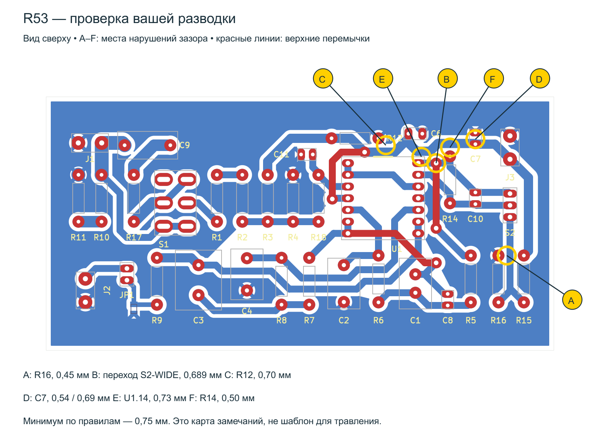

# Проверка пользовательской платы R53 от 04.11.2026

Проверен архив `R53_ERC_CHECK.rar`, переданный владельцем после самостоятельной
разводки. **Электрическая схема соответствует R5.1, но PCB требует доработки
перед изготовлением: DRC обнаружил 9 нарушений зазора.** Пользовательские
файлы не исправлялись, старый проект не подставлялся вместо новой разводки.

## Проверенный комплект

- [Сохранённый исходный архив](../../design/r53-user-20261104/R53_ERC_CHECK.rar),
  включая его историю: SHA256 `87f4733ead903160c63cd6593d11a0868c7b92349a7d53c5707104ec14fbf979`.
- [Проект из архива](../../design/r53-user-20261104/project/analog-input-r53.kicad_pro)
  и [PCB](../../design/r53-user-20261104/project/analog-input-r53.kicad_pcb).
  Извлечённые текущие файлы побайтно совпадают с рабочей копией проверки;
  `.history` остаётся в оригинальном архиве.
- PCB SHA256 `73b1efdadeda09ced3e38c074e75e8204914c9fcbf023f96bf9e01aa064fcce9`.
- SCH SHA256 `344543ffd7bbee30b31c32625e88b2890b3e21d5e24f6f36e4e119c66a486d58`.

## Что подтверждено в CAD

| Проверка | Результат |
|---|---|
| ERC схемы, KiCad CLI 10.0.6 | 0 ошибок, 0 предупреждений |
| Схема против исходной R5.1 | 35 номиналов и полные группы всех 87 выводов в 23 цепях совпадают |
| PCB против схемы, DRC schematic parity | 0 расхождений |
| Несоединённые элементы после пересчёта заливки | 0, с учётом всех верхних соединений |
| Контур платы по центру Edge.Cuts | 110 × 55 мм; X=28…138, Y=25…80 мм |
| Дорожки | 142 отрезка шириной 1–3 мм; 135 на B.Cu и 7 на F.Cu |
| Сторона компонентов | Сверху, кроме C5 снизу |
| Узлы схемы | 137 проводов с явной шириной 0,1524 мм; 32 точки соединения |

Пользователь отдельно подтвердил, что F.Cu обозначает **проволочные перемычки
сверху**, а не вторую травимую сторону. Нулевое число обрывов относится к
CAD-модели с этими соединениями; без их монтажа физическая плата не соответствует
проверенной модели. Нового автоматического цикла открытия GUI здесь не было:
в предыдущем сообщении пользователь сообщил ERC 0/0, затем завершение работы.

## Обязательные исправления зазоров



В таблице координаты — **абсолютные координаты KiCad в миллиметрах, вид сверху**.
Для отсчёта от левого верхнего угла платы вычесть 28 из X и 25 из Y.
Несколько нарушений относятся к одному месту, поэтому 9 сообщений сгруппированы
в 6 областей. Целевой минимум — 0,75 мм; удобно оставить запас до 0,8–1 мм,
если он получается без ухудшения других соединений.

| Метка | Где искать | Зазор | Сообщений DRC |
|---|---|---:|---:|
| A | R16.2, (126; 59,42), рядом с дорожкой S2-SENS, начинающейся (128,5; 66,08) | 0,45 мм | 1 |
| B | Переход S2-WIDE, (112,5; 39,38), и два соседних отрезка питания V_A | 0,689 мм | 2 |
| C | R12.2, (100; 34), рядом с питанием V_A от (103,5; 37) | 0,70 мм | 1 |
| D | Земляная площадка C7.2, (121; 32,73), и два отрезка V_A | 0,54 и 0,69 мм | 2 |
| E | U1.14, (108,62; 39,38), и два соседних отрезка питания | 0,73 мм | 2 |
| F | R14.2, (115,5; 37,92), рядом с V_A от (120,85; 35,12) | 0,50 мм | 1 |

Нужно отодвинуть соответствующий отрезок/площадку или изменить его подход,
сохранив ширину меди не менее 1 мм. Уменьшать правило зазора для получения
нулевого DRC не предлагается. Точные UUID и координаты обоих участников
каждого нарушения сохранены в [полном DRC](drc-project.json).

## Три верхние перемычки

Их можно оставить проволочными; пять vias служат отверстиями для концов
проводов, а шестой конец приходит на U1.7. В домашней односторонней плате
металлизации отверстий нет: каждый конец должен иметь реальный паяный
контакт с нужной нижней медью/выводом. Изолированный провод нужен там,
где он проходит над выводами, переходником или чужими цепями.

| Условное имя в этом отчёте | Цепь | Концы, координаты KiCad | Длина линии CAD |
|---|---|---|---:|
| J-A | V_A, питание | (97; 37) → (90; 47,16) | около 16,00 мм |
| J-B | S2-WIDE | (112,5; 39,38) → (112,5; 53,5) | 14,12 мм |
| J-C | Выход первого фильтра, Net-(U1B--) | (112,5; 61) → U1.7, (93,38; 54,62) | около 21,76 мм |

Это новые обозначения только для пояснения, не прежние W1–W9. Длина линии
не равна длине отрезаемой заготовки: нужны изгибы и заход в отверстия.
J-C проходит в области переходника U1: проверить свободное место и доступ
к пайке; при необходимости поставить провод до переходника. Печатать для
травления только B.Cu; F.Cu в этой версии служит монтажной подсказкой.

## Посадки: 5 предупреждений, требующих осмысленной сверки

DRC сравнил установленную посадку с `LUT.pretty` и обнаружил изменения.
Они могут быть правильной подгонкой под купленные детали и не означают
ошибку электрических соединений.

| Деталь | Шаг в библиотеке | Шаг на пользовательской плате |
|---|---:|---:|
| C6 | 2,54 мм | 3 мм |
| C9 | 5 мм | 9,9 мм |
| C4 | 4 мм | 7 мм |
| C2 | 4 мм | 8 мм |

У S1 изменены расположение номеров площадок и сверления: овальные отверстия
1,1 × 2,8 мм. Проверить фактический тумблер и способ изготовления продолговатых
отверстий. В текущем **виде сверху** ряды сверху вниз имеют номера
**6–3, 5–2, 4–1** (слева–справа). Общие контакты — 2 и 5. В DC должны
замыкаться пары 1–2 и 4–5; в AC — 2–3 и 5–6. Контакт 6 не подключён
к измерительной цепи. Соответствие ножек реального переключателя проверяется
омметром, а не по внешнему виду корпуса.

Не применять «обновить все посадки из библиотеки» вслепую: это отменит
пользовательские изменения. После примерки следует сохранить именно
подтверждённые посадки в локальной библиотеке.

## Аналоговая компоновка и ЛУТ

1. **C6 — развязка питания.** Путь от C6.1 к U1.4 по центрам проводников
   получился около 31,28 мм и проходит через верхнюю перемычку питания.
   Конденсатор визуально рядом с U1, но электрически соединён длинным путём.
   Предлагается расположить развязку ближе к фактическим ножкам питания
   усилителя/переходника и сократить обе ветви петли питания–земли.
   Расчёт длины не доказывает наличие шума или возбуждения: измерений нет.
2. **Запрет заливки у чувствительного входа сместился.** Имеющийся keepout
   начинается с Y=46 мм. Участок IN_A — C11.1 (85,77;37,5), R18.2
   (87;41,92), U1.3 (93,38;44,46) — находится выше и этой областью не закрыт.
   Для сохранения прежнего решения нужно вернуть локальный запрет заливки
   непосредственно к C11.1→U1.3. Большой вырез под фильтрами не заменяет его.
   Паразитная ёмкость и фактическая полоса этой разводки не измерены.
3. **Полигон AGND.** Сейчас задан отступ 0,8 мм и минимальная толщина
   заливки 0,25 мм; раньше проектировался отступ 1 мм. Правило дорожек
   ≥1 мм соблюдено, но само по себе оно не запрещает тонкие перемычки
   внутри полигона. Перед печатью нужно выбрать технологический минимум
   для заливки, пересчитать её и снова проверить связность. 0,25 мм —
   настройка, а не измеренный минимум каждого реального перешейка.
4. **Разъёмы после вашей перестановки.** J1: справа контакт 1/CH1,
   слева 2/AGND. J2: сверху 1/PA0, снизу 2/AGND. J3: сверху 2/AGND,
   снизу 1/V_A. Это вид сверху текущей PCB. Прежние монтажные карты R5.3
   88×55 мм и таблица W1–W9 к новой плате 110×55 мм не подходят.

## Почему старые ошибки схемы сейчас не повторяются

В архивной схеме у всех 137 проводов явно записана положительная ширина
0,1524 мм, точки соединения сохранены. Это тот вариант, который пользователь
проверил с ERC 0/0. В классах Default и LUT проекта всё ещё отсутствуют
поля схемных ширин `wire_width`, `bus_width`, `line_style`. Независимый разбор
исходников KiCad связал прежнее исчезновение узлов с отсутствующей наследуемой
шириной; явные ширины обходят этот путь. При следующем согласованном изменении
проекта стоит дополнить классы значениями 6, 12 mils и 0 соответственно,
чтобы новые провода с шириной «по умолчанию» не возвращали этот риск.
В текущем аудите ни проект, ни генератор не изменялись.

## Как воспроизвести и как продолжить

Выполнены один ERC, один DRC с пересчётом заливки **в памяти, без сохранения
PCB**, один экспорт netlist, сравнение полных групп выводов и чтение геометрии.
Команды KiCad 10.0.6 для извлечённой копии:

```text
kicad-cli sch erc --format json --severity-all --output erc.json analog-input-r53.kicad_sch
kicad-cli pcb drc --format json --severity-all --all-track-errors --schematic-parity --refill-zones --output drc.json analog-input-r53.kicad_pcb
kicad-cli sch export netlist --format kicadxml --output netlist.xml analog-input-r53.kicad_sch
```

Настройки исключений не менялись. В проекте нет индивидуальных DRC exclusions;
есть 5 отключённых типов DRC и 4 типа ERC, перечисленных в исходных JSON-отчётах.
В sandbox KiCad писал диагностические сообщения о недоступном HKCU, но все
три команды завершились с кодом 0 и создали полные отчёты/нетлист. Это не
проверка пользовательского GUI и не изменение его глобальных настроек.

Следующий этап: точечно исправить зазоры и аналоговую компоновку, подтвердить
посадки, оформить три перемычки и актуальную монтажную карту, затем повторить
только затронутый DRC. Пользовательская разводка сохранена как основа;
перегенерировать её целиком не требуется. Изготовление, точность пересчёта,
защита входа, полоса и подключение к автомобилю этим аудитом не подтверждены.

Машинные свидетельства: [audit.json](audit.json), [ERC](erc.json),
[DRC](drc-project.json), [netlist](netlist.xml), [manifest](manifest.json).
Независимое заключение — [отчёт критика](../../reviews/r53-user-review-20261104.md).
